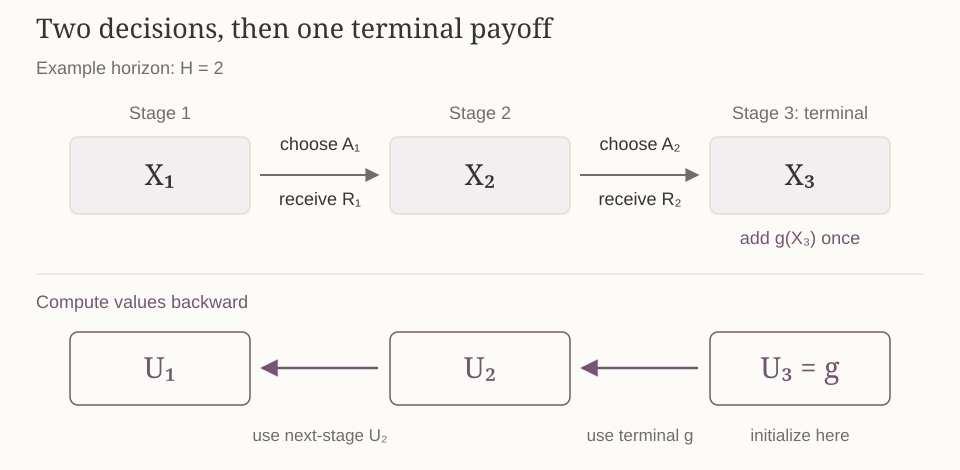
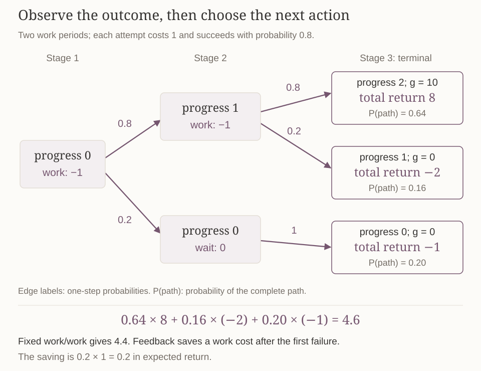
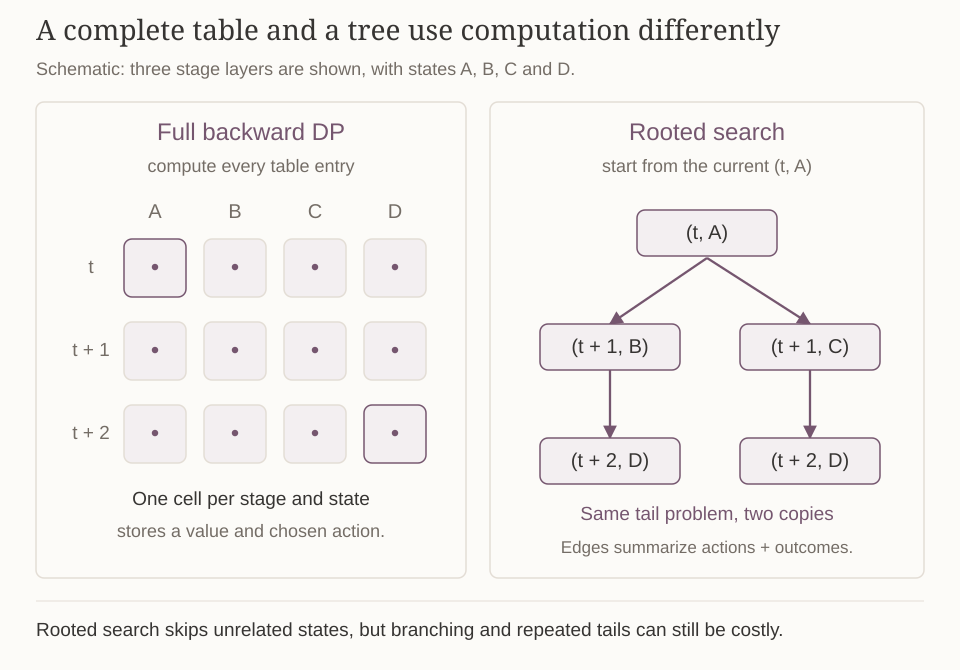
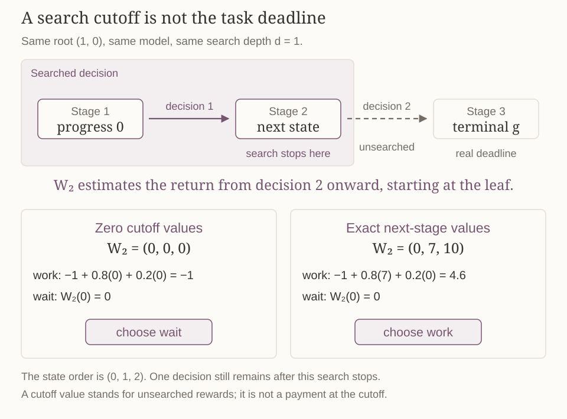
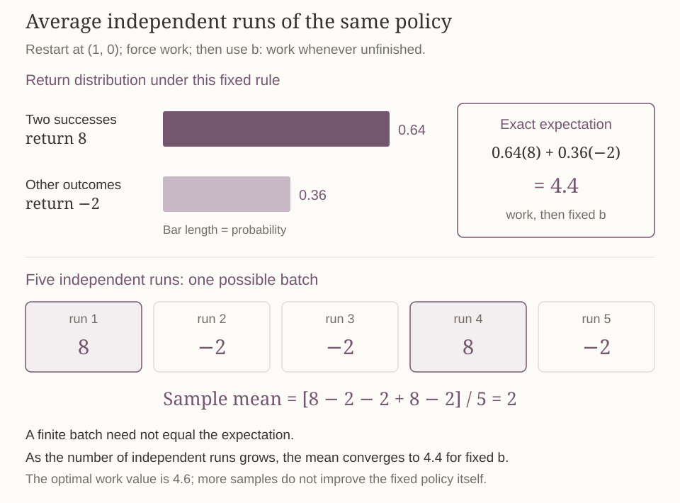
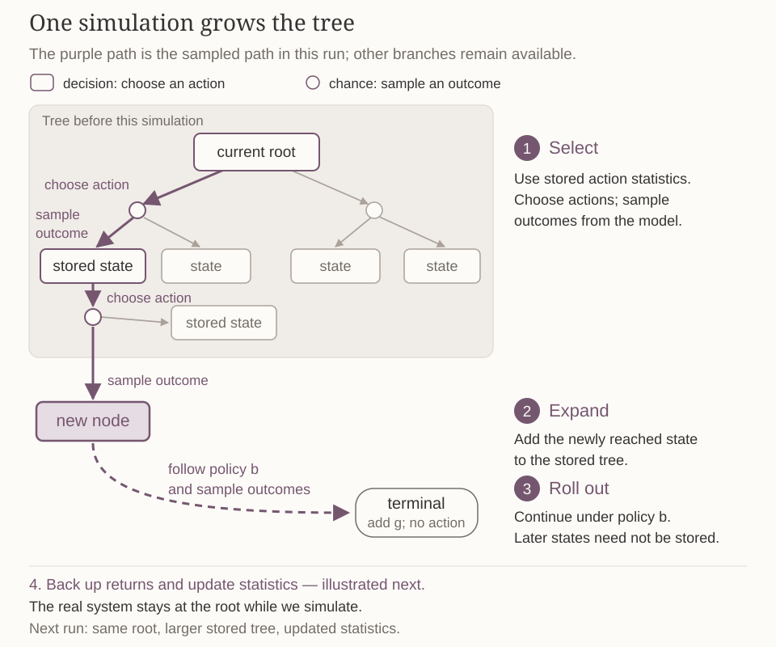
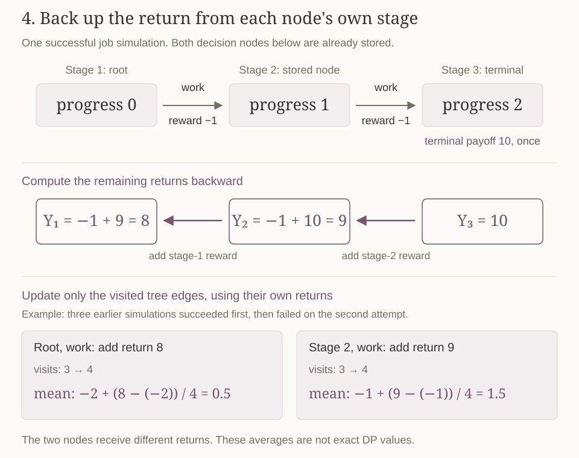

The [previous note](value-and-policy-iteration.md) studied a continuing discounted task. Value iteration repeatedly updates a table until it approaches a fixed point. A task with a deadline has a different starting point: after the final decision, the remaining payoff is already known. We can therefore compute backward from that boundary in finitely many steps.

This note develops that calculation, proves why it produces an optimal policy, and then asks how to act when computing a complete table is too expensive. Online planning concentrates computation on the current decision. Limited lookahead replaces the unsearched future with a value estimate; simulation and Monte Carlo tree search replace exhaustive branching with sampled futures. The model can remain known throughout.

*Click an illustration to enlarge it.*

## A deadline changes the value, even when the model is unchanged {#finite-model}

There are $H$ decisions, at stages $t=1,\ldots,H$. The finite state set $\mathcal X$ is nonempty, and each state has a finite, nonempty feasible-action set $\mathcal A(x)$. The interaction at stage $t$ is

$$
X_t\ \longrightarrow\ A_t\ \longrightarrow\ (R_t,X_{t+1}).
$$

The reward $R_t$ belongs to the current action. After decision $H$, the agent reaches $X_{H+1}$ and receives a prescribed terminal payoff $g(X_{H+1})$. There is no action at stage $H+1$. The remaining return is

$$
G_t=\sum_{s=t}^{H}R_s+g(X_{H+1}),
\qquad G_{H+1}=g(X_{H+1}).
$$ {#eq-finite-return}

The terminal payoff is paid **once**. If the task has no additional final payoff, set $g=0$. For example, inventory left after the final selling day might have salvage value $g(x)=2x$. This value is added to the earlier sales rewards; it is not another selling decision. A finite sum permits the undiscounted objective used here without an infinite-series convergence argument.

We keep the same physical model at every stage. Given the observed history and action, the known joint law of $(R_t,X_{t+1})$ depends only on $(X_t,A_t)$ and is unchanged with time. Write $r(x,a)$ for the mean reward and $\mathcal P(x'\mid x,a)$ for the next-state probabilities. Assume $|R_t|\leq R_{\max}$ and $|g(x)|\leq g_{\max}$. These bounds make every remaining return integrable. Reward and next state may be correlated; the Bellman calculation does not require independence.

There is no stage index on $r$, $\mathcal P$, or $\mathcal A(x)$. The clock changes how much time remains, even though it does not change the physical rules. With one state, one action, reward $1$ at every decision, and $g=0$, the remaining value is $H-t+1$. Consequently, a value function needs a stage index.

### Policies and tail problems

Before decision $t$, the history is

$$
H_t=(X_1,A_1,R_1,\ldots,X_{t-1},A_{t-1},R_{t-1},X_t).
$$

An admissible policy $\rho$ chooses action probabilities $\rho_t(\cdot\mid H_t)$ using this history and no future information. A **stage-Markov policy** is a sequence $\pi=(\pi_1,\ldots,\pi_H)$, where $\pi_t(\cdot\mid x)$ depends on the current stage and state. A deterministic stage-Markov policy chooses one action $\pi_t(x)$.

For such a policy, start a tail problem at stage $t$ with state $x$ and define

$$
V_t^\pi(x)=\mathbb E_{t,x}^\pi[G_t].
$$

The subscript $t,x$ specifies this initialization; it does not condition an earlier run on an event that might have probability zero. The optimal tail value allows all admissible tail policies:

$$
V_t^*(x)=\sup_\rho\mathbb E_{t,x}^\rho[G_t],
\qquad V_{H+1}^*(x)=g(x).
$$

We will construct candidate tables $U_t$ and then prove that $U_t=V_t^*$. Allowing history-dependent policies in the definition does not assume that they are necessary for optimality.

### Evaluating a fixed policy

The decomposition $G_t=R_t+G_{t+1}$ gives a backward evaluation rule. Condition first on the current action and then on the next state:

$$
V_t^\pi(x)=\sum_{a\in\mathcal A(x)}\pi_t(a\mid x)
\left[r(x,a)+\sum_{x'\in\mathcal X}\mathcal P(x'\mid x,a)V_{t+1}^\pi(x')\right],
\qquad V_{H+1}^\pi=g.
$$ {#eq-finite-evaluation}

Each step uses the already computed next-stage table. For a deterministic policy, the action average selects $a=\pi_t(x)$. This state-only recursion evaluates a stage-Markov policy; an arbitrary history-dependent rule may require retaining the history when evaluating its future decisions.

## A job with two periods remaining {#job-deterministic}

A job requires two units of progress and has a deadline after two work periods, so $H=2$. The state $x\in\{0,1,2\}$ records completed units. At $x<2$, the available actions are work $w$ and wait $q$. Working costs $1$; waiting costs nothing. At $x=2$, only waiting is feasible. The completion bonus is

$$
g(0)=g(1)=0,\qquad g(2)=10,
$$

paid at stage $3$. Completing the job is rewarded, rather than imposed as a constraint: an unfinished job may leave the agent with work costs and no bonus.

First suppose every work attempt succeeds. Work moves $x$ to $x+1$ and gives reward $-1$; wait stays at $x$ and gives reward $0$. Start with $U_3=g$. With one decision left, an action earns its immediate reward plus the terminal payoff at the resulting state:

| State | Work score at stage 2 | Wait score at stage 2 | $U_2(x)$ | Selected action |
|:--|:--|:--|--:|:--|
| $0$ | $-1+g(1)=-1$ | $g(0)=0$ | $0$ | $q$ |
| $1$ | $-1+g(2)=9$ | $g(1)=0$ | $9$ | $w$ |
| $2$ | Infeasible | $g(2)=10$ | $10$ | $q$ |

Thus $U_2=(0,9,10)^\top$ in state order $(0,1,2)$. With two decisions left, use this table to account for everything after the current action:

| State | Work score at stage 1 | Wait score at stage 1 | $U_1(x)$ |
|:--|:--|:--|--:|
| $0$ | $-1+U_2(1)=8$ | $U_2(0)=0$ | $8$ |
| $1$ | $-1+U_2(2)=9$ | $U_2(1)=9$ | $9$ |
| $2$ | Infeasible | $U_2(2)=10$ | $10$ |

The terminal bonus is already included in $U_2$ and must not be added again. From progress $0$, working twice gives $-1-1+10=8$. With only one period left, beginning the same job loses $1$ without earning a bonus. The best action at the **same physical state** changes with the stage: work at $(1,0)$, wait at $(2,0)$.

## Backward dynamic programming {#backward-dp}

For uncertain transitions, an action can lead to several next states. Average their next-stage values using the known probabilities. Given $U_{t+1}$, define

$$
B_t(x,a)=r(x,a)+\sum_{x'\in\mathcal X}\mathcal P(x'\mid x,a)U_{t+1}(x').
$$

This is the expected current reward plus the candidate value from stage $t+1$ onward. Construct

$$
U_t(x)=\max_{a\in\mathcal A(x)}B_t(x,a),
\qquad
\pi_t^*(x)\in\operatorname*{argmax}_{a\in\mathcal A(x)}B_t(x,a),
\qquad U_{H+1}=g.
$$ {#eq-backward-dp}

The maximum is a number; the selected maximizer is an action. Finite, nonempty action sets ensure that a maximizer exists. Fix a choice at each tie, giving one complete policy sequence.

The algorithm initializes the terminal table and computes stages $H,H-1,\ldots,1$. Within stage $t$, every action score uses the completed table $U_{t+1}$. Execution goes in the other direction: at each real decision, observe $X_t$ and choose $\pi_t^*(X_t)$.

{#fig-finite-horizon-timeline fig-alt="Two-decision timeline with forward actions and rewards, and backward value calculation from U3 equals g to U2 to U1."}

Previously, the discounted Bellman equation used the same unknown table on both sides:

$$
U(x)=\max_a\left[r(x,a)+\gamma\sum_{x'}\mathcal P(x'\mid x,a)U(x')\right].
$$

The finite-horizon equation links $U_t$ to $U_{t+1}$, with a known endpoint. There are exactly $H$ backward stages; we do not wait for a fixed-point iteration to converge. The following proof identifies the constructed tables with optimal returns.

::: {#thm-finite-optimality}
## Optimality of backward dynamic programming

Under the finite-model assumptions above, the tables and stored policy from @eq-backward-dp satisfy

$$
V_t^{\pi^*}(x)=U_t(x)=V_t^*(x)
$$

at every stage and state. The same deterministic stage-Markov policy sequence is optimal for all tail problems, including comparison against policies that randomize and use the full history.
:::

::: {.proof}
First prove an upper bound for an arbitrary admissible policy $\rho$. We show backward that

$$
\mathbb E^\rho[G_t\mid H_t]\leq U_t(X_t)
$$

with probability one. At $H+1$, both sides equal $g(X_{H+1})$. Suppose the inequality holds at stage $t+1$. The return decomposition and tower property give

$$
\begin{aligned}
\mathbb E^\rho[G_t\mid H_t]
&=\mathbb E^\rho[R_t+G_{t+1}\mid H_t]\\
&=\mathbb E^\rho\!\left[R_t+\mathbb E^\rho[G_{t+1}\mid H_{t+1}]\mid H_t\right]\\
&\leq\mathbb E^\rho[R_t+U_{t+1}(X_{t+1})\mid H_t].
\end{aligned}
$$

Here $H_{t+1}=(H_t,A_t,R_t,X_{t+1})$ contains both $H_t$ and the received reward. The inequality follows from the induction hypothesis and preservation of inequalities by conditional expectation.

Condition additionally on $A_t$. The model and linearity give

$$
\mathbb E^\rho[R_t+U_{t+1}(X_{t+1})\mid H_t,A_t]
=r(X_t,A_t)+\sum_{x'}\mathcal P(x'\mid X_t,A_t)U_{t+1}(x')
=B_t(X_t,A_t).
$$

This step uses the reward mean and transition marginal; it does not factor a joint expectation into independent components. Average over the action chosen by $\rho$:

$$
\begin{aligned}
\mathbb E^\rho[R_t+U_{t+1}(X_{t+1})\mid H_t]
&=\sum_{a\in\mathcal A(X_t)}\rho_t(a\mid H_t)B_t(X_t,a)\\
&\leq\max_{a\in\mathcal A(X_t)} B_t(X_t,a)=U_t(X_t).
\end{aligned}
$$

A probability-weighted average cannot exceed the largest entry. This completes the induction. Starting from any $(t,x)$ and taking the supremum over admissible tail policies yields $V_t^*(x)\leq U_t(x)$.

Next prove attainment by the **same stored sequence** $\pi^*$. At the boundary, $V_{H+1}^{\pi^*}=g=U_{H+1}$. If $V_{t+1}^{\pi^*}=U_{t+1}$ at every state, policy evaluation gives

$$
\begin{aligned}
V_t^{\pi^*}(x)
&=r(x,\pi_t^*(x))+\sum_{x'}\mathcal P(x'\mid x,\pi_t^*(x))V_{t+1}^{\pi^*}(x')\\
&=B_t(x,\pi_t^*(x))=U_t(x).
\end{aligned}
$$

The last equality is the stored maximizing choice. Since $\pi^*$ is admissible, $V_t^{\pi^*}(x)\leq V_t^*(x)$. Together with the upper bound, this proves all three quantities equal. No infinite limit or contraction argument is needed.
:::

## Uncertain progress: compute and verify the optimal policy {#job-stochastic}

Keep the same job, but let a work attempt succeed with probability $p=0.8$. Each attempt still costs $1$, including a failure. The complete physical model is:

| State | Action | Reward | Next-state distribution |
|:--|:--|--:|:--|
| $x<2$ | Work $w$ | $-1$ | $x+1$ with probability $0.8$; $x$ with probability $0.2$ |
| $x<2$ | Wait $q$ | $0$ | Stay at $x$ |
| $x=2$ | Wait $q$ only | $0$ | Stay at $2$ |

There are two decisions, and $g=(0,0,10)^\top$ is paid at stage $3$. For $x<2$, the backward rule is

$$
U_t(x)=\max\left\{-1+0.8U_{t+1}(x+1)+0.2U_{t+1}(x),\ U_{t+1}(x)\right\}.
$$

The two scores are work and wait. At state $2$, only waiting is possible, so $U_t(2)=U_{t+1}(2)$.

### Start with the last decision

Substitute $U_3=g$:

$$
\begin{aligned}
U_2(0)&=\max\{-1+0.8(0)+0.2(0),\ 0\}=0,\\
U_2(1)&=\max\{-1+0.8(10)+0.2(0),\ 0\}=7,\\
U_2(2)&=10.
\end{aligned}
$$

Thus $U_2=(0,7,10)^\top$, with actions $(q,w,q)$. Starting at progress $0$, one remaining attempt cannot finish two units. Starting at progress $1$, the expected bonus $0.8\times10$ exceeds the work cost.

### Use the solved last-stage table

At stage $1$,

$$
\begin{aligned}
U_1(0)&=\max\{-1+0.8(7)+0.2(0),\ 0\}=4.6,\\
U_1(1)&=\max\{-1+0.8(10)+0.2(7),\ 7\}=8.4,\\
U_1(2)&=10.
\end{aligned}
$$

The complete result is

| Stage | $U_t(0)$ | $U_t(1)$ | $U_t(2)$ | Selected actions at $0,1,2$ |
|--:|--:|--:|--:|:--|
| $3$ | $0$ | $0$ | $10$ | No decision |
| $2$ | $0$ | $7$ | $10$ | $q,w,q$ |
| $1$ | $4.6$ | $8.4$ | $10$ | $w,w,q$ |

At initial state $0$, work first. If it succeeds, work again from progress $1$; if it fails, wait because completion is now impossible. The expected return can be checked directly from the three resulting paths:

| Outcomes under this policy | Probability | Total return |
|:--|--:|:--|
| First work succeeds; second succeeds | $0.64$ | $-1-1+10=8$ |
| First work succeeds; second fails | $0.16$ | $-1-1+0=-2$ |
| First work fails; then wait | $0.20$ | $-1+0+0=-1$ |

Their weighted sum is $0.64(8)+0.16(-2)+0.20(-1)=4.6$, agreeing with $U_1(0)$.

This is a **feedback policy**, whose second action responds to the observed state. Committing in advance to work twice gives expected return $-2+10(0.8)^2=4.4$. Feedback saves the second work cost on the first-failure branch, which has probability $0.2$. An action sequence and a policy therefore solve different decision problems when outcomes are uncertain.

{#fig-job-feedback-policy fig-alt="A job feedback tree: work first; success with probability 0.8 leads to another work attempt, while failure with probability 0.2 leads to waiting. The three complete paths have probabilities 0.64, 0.16, 0.20 and returns 8, minus 2, minus 1, giving expected return 4.6."}

## What the state remembers, and what a full calculation costs {#state-and-cost}

The job calculation reused one value for every history reaching the same stage and progress. To reuse calculations this way in a larger problem, the state must retain the information that determines future rewards and feasible decisions.

Two histories summarized by the same stage and state must permit the same actions and have the same conditional outcome law under each action. The terminal state must also determine the terminal payoff. Progress is sufficient for this job because no additional resource or hidden work condition changes these rules. If a remaining budget affects feasibility, it must be included in the state.

The augmented state $(t,x)$ includes the clock. A rule stationary in this augmented state can represent the stage-dependent rule $\pi_t(x)$. This does not mean that the original physical-state policy is stationary.

Let $n=|\mathcal X|$, with at most $m$ feasible actions per state. A full backward computation evaluates $O(Hnm)$ action scores. For dense transitions, each expected next value uses $O(n)$ arithmetic, so the total cost is $O(Hn^2m)$. Sparse transitions can reduce the averaging cost.

Storing all value layers and selected actions takes $O(Hn)$ entries, excluding storage of the model. Two consecutive value layers need only $O(n)$ entries if earlier values can be discarded, although retaining the complete policy still takes $O(Hn)$ actions. If the state has $k$ coordinates with $s$ possible values each, there may be $s^k$ states. A sufficient state can consequently be expensive to enumerate.

## Online planning: compute the action needed now {#online-planning}

A complete DP table answers every stage–state query. An online planner instead receives the current $(t,x)$, spends a computation budget, and returns an action at this root. Repeating that procedure after each real observation implements a policy, even if the planner never stores a complete policy table.

The loop is: observe the real state, plan from it, execute **one** action, observe the actual outcome, and plan again. Simulated actions do not move the real system. The word “online” here describes when planning is performed; it does not by itself mean that the model is unknown or being learned.

There are two useful ways to access a known model:

| Access | What a query supplies | How it supports planning |
|:--|:--|:--|
| Explicit probabilities | $r(x,a)$ and the distribution $\mathcal P(\cdot\mid x,a)$ | Sum over successor states to calculate expectations |
| A simulator or generator | A random next state for a queried imagined $(x,a)$, with known mean reward or a correctly sampled reward | Generate possible trajectories and estimate expectations from them |

A generator must support the queries used in planning, including restarting at an imagined root. A single real trajectory without reset or arbitrary-state access does not automatically provide this capability.

### Search alternates choices and random outcomes

A rooted search tree has two kinds of branching. At a decision node, the planner chooses among feasible actions. After an action, a chance node represents possible outcomes. The planner maximizes over actions but averages over chance outcomes; it cannot select a favorable random outcome.

At the next state, a later action may depend on the outcome just observed. This is why the next-state value already contains its own maximization. Expanding the stochastic job for two decisions gives the same root work score as backward DP:

$$
-1+0.8\underbrace{U_2(1)}_{7}+0.2\underbrace{U_2(0)}_{0}=4.6.
$$

A tree may contain several nodes representing the same stage and physical state, reached by different histories. A full DP table shares their tail calculation. Rooted search avoids unrelated states but can duplicate reachable tail problems.

If an action has at most $b$ possible successors and a state at most $m$ actions, an unmerged tree can contain as many as $(mb)^d$ state nodes at depth $d$. Concentrating on one root does not by itself make exhaustive search inexpensive.

{#fig-full-dp-vs-rooted-search fig-alt="A grid of stage-state DP entries beside a rooted search tree. DP fills the whole grid; online search expands from one current stage-state pair. Repeated appearances of the same stage and state in the tree share one table entry in DP."}

## Limited lookahead and the meaning of a leaf value {#lookahead}

The tree-size bound gives a reason to stop search before the deadline. Stopping computation does not remove rewards from the task, so the remaining decisions must still be accounted for through a value estimate at the search boundary.

At stage $t$, choose a search depth $1\leq d\leq H-t+1$. A depth of $d$ counts $d$ decisions, each including its random outcome; chance nodes do not count as additional decisions. The search stops at stage $t+d$.

- If $t+d=H+1$, the leaf value is the true terminal payoff $g$.
- If $t+d\leq H$, decisions remain after the search stops. Supply a function $W_{t+d}(x)$ estimating their rewards and the eventual terminal payoff.

The function $W$ is a planning approximation, not a reward paid at the cutoff. In particular, $g=0$ does not imply $W=0$: future ordinary rewards may remain. A heuristic, a previously computed table, or the value of a feasible base policy can supply $W$.

Let $Z_s(y)$ denote the value computed inside this search at stage $s$ and state $y$. Initialize its leaves with $Z_{H+1}=g$ at the actual deadline, or with $Z_{t+d}=W_{t+d}$ at an earlier cutoff. Then compute

$$
Z_s(y)=\max_{a\in\mathcal A(y)}\left[r(y,a)+\sum_{y'}\mathcal P(y'\mid y,a)Z_{s+1}(y')\right],
\qquad s=t+d-1,\ldots,t.
$$

Choose a maximizing action at the root. Within the searched portion, this exact recursion includes every feasible action and every successor with positive probability. An approximate leaf value can still make the root choice wrong.

### A zero cutoff value can remove the reason to begin

Return to the stochastic job at $(t,x)=(1,0)$. A one-decision search stops at stage $2$, before the completion bonus. With $W_2\equiv0$, its scores are

$$
\text{work: }-1+0.8(0)+0.2(0)=-1,
\qquad \text{wait: }0.
$$

It chooses wait. The real system then reaches $(2,0)$, where one remaining decision cannot complete the job. Replanning now uses the true terminal payoff, but the scores are still $-1$ for work and $0$ for wait. The resulting policy earns $0$, compared with optimal expected return $4.6$.

Searching two decisions reaches the actual endpoint and recovers the correct choice. Keeping depth one but using $W_2=(0,7,10)^\top$ also gives the correct root scores. Both methods account for the unsearched benefit; simply replanning later cannot undo the lost first period. With arbitrary cutoff approximations, a deeper search need not improve the actual policy.

{#fig-search-cutoff-vs-deadline fig-alt="For the two-period job, stage 2 is an artificial depth-one cutoff, not the terminal stage. Zero cutoff values give work score minus 1 and wait score 0; the exact next-stage values give work score 4.6 and wait score 0. The remaining decision and terminal bonus are beyond the cutoff."}

### Supplementary derivation: how leaf error affects a root decision

The job example shows that a poor cutoff estimate can reverse the root choice. We now quantify how a bound on leaf-value error controls the root action scores and the loss of the selected current action.

Suppose at the cutoff $k=t+d$ the approximation satisfies $|W_k(y)-V_k^*(y)|\leq\varepsilon$ for every leaf state reachable in the search. Exact expectation and maximization do not enlarge this uniform error. Indeed, if the next-stage difference is at most $\varepsilon$, each action-score difference is bounded by

$$
\left|\sum_{y'}\mathcal P(y'\mid y,a)[Z_{s+1}(y')-V_{s+1}^*(y')]\right|
\leq\sum_{y'}\mathcal P(y'\mid y,a)\varepsilon=\varepsilon.
$$

For any two finite lists, $|\max_a u_a-\max_a v_a|\leq\max_a|u_a-v_a|$, as proved in the [Bellman-operator note](bellman-operators.md#contraction). Applying this inequality backward gives error at most $\varepsilon$ in every root action score.

Write $\widetilde Q_t(x,a)$ for these search scores and $Q_t^*(x,a)$ for the score of taking $a$ and then acting optimally. Let $\widehat a$ maximize $\widetilde Q_t$ and let $a^*$ maximize $Q_t^*$. Then

$$
\begin{aligned}
V_t^*(x)-Q_t^*(x,\widehat a)
&=Q_t^*(x,a^*)-Q_t^*(x,\widehat a)\\
&\leq [Q_t^*(x,a^*)-\widetilde Q_t(x,a^*)]
 +[\widetilde Q_t(x,\widehat a)-Q_t^*(x,\widehat a)]\\
&\leq2\varepsilon.
\end{aligned}
$$

The middle omitted difference is nonpositive because $\widehat a$ maximizes the search score. This bounds the loss of the **current action followed by optimal continuation**. It does not by itself bound the return loss of an entire policy that makes additional approximate decisions later. Unlike discounted lookahead, this undiscounted calculation has no factor $\gamma^d$ shrinking the leaf error.

## Estimate returns with simulated trajectories {#simulation}

Limiting depth reduces how far we search, but each searched decision can still have many possible outcomes. We can estimate expectations using sampled trajectories. To give each trajectory a return, we must specify how it continues after its first action.

Fix the current root $(t,x)$, force a candidate first action $a$, and then follow a fixed stage-Markov **rollout policy** $b=(b_1,\ldots,b_H)$. This policy specifies how to finish each simulated run; it need not be optimal.

At each simulated step, draw the next state from $\mathcal P(\cdot\mid x_s,a_s)$. Following the slides, use the known mean reward $c_s=r(x_s,a_s)$ and form

$$
Y=\sum_{s=t}^{H}c_s+g(x_{H+1}).
$$

The simulated states and actions are random. Replacing the realized reward by its conditional mean preserves the expected return for this fixed stage-Markov rollout policy: the state-transition law is unchanged, and each expected reward contribution equals $\mathbb E[r(X_s,A_s)]$. It does not assert that the distribution of $Y$ equals the distribution of actual returns. A simulator that correctly samples the joint reward and next state can instead use those sampled rewards.

Run $K$ independent simulations with the same root, forced action, and rollout policy, and average:

$$
\widehat Q_t^b(x,a)=\frac1K\sum_{j=1}^K Y^{(j)}.
$$

Here $Q_t^b(x,a)$ denotes the expected return of taking $a$ first and following $b$ afterward. Independent bounded runs and the law of large numbers give $\widehat Q_t^b(x,a)\to Q_t^b(x,a)$ as $K\to\infty$. This estimates the specified policy's continuation, **not automatically the optimal continuation**. A finite average also has sampling error.

For the job, force work first and let $b$ work whenever the job is unfinished. From initial progress $0$, this means two attempts. Both succeed with probability $0.64$, giving return $8$; all other outcomes give return $-2$. Therefore

$$
Q_1^b(0,w)=0.64(8)+0.36(-2)=4.4.
$$

The optimal work score is $4.6$ because its continuation waits after an initial failure. More simulations of the fixed policy $b$ reduce sampling error around $4.4$; they do not turn that policy into the optimal one.

{#fig-rollout-average fig-alt="The fixed policy works twice from progress zero. Two successes give return 8 with probability 0.64; the other outcomes give minus 2 with probability 0.36. Five illustrative returns 8, minus 2, minus 2, 8, minus 2 average to 2, compared with expected return 4.4."}

At an earlier rollout cutoff $k$, the simulated sum through stage $k-1$ can be followed by $W_k(x_k)$. Choosing $W_k=V_k^b$ preserves the expected fixed-policy return by the tower property. An arbitrary approximation introduces an additional leaf-value error.

## Monte Carlo tree search {#mcts}

More simulations of the fixed rollout policy estimate its return more accurately, but leave its continuation rule unchanged. We would like simulations to help choose actions at later states as well. **Monte Carlo tree search (MCTS)** stores a partial tree so that accumulated return estimates guide those choices, while a rollout policy supplies the unexpanded tail.

Each decision node represents a simulated history ending at a stage and state. Chance nodes represent the random outcomes after a chosen action. For a stored decision node $n$ and a tried action $a$, keep a visit count $N(n,a)$ and an empirical mean remaining return $\overline Q(n,a)$.

One simulation follows four steps:

1. **Select.** Starting at the root, follow the stored tree. Choose actions using its current statistics, while drawing random outcomes from the model. Try untried actions and balance promising returns against limited information.
2. **Expand.** When the simulation reaches a new node outside the stored tree, add it. The tree grows selectively rather than recording every possible future.
3. **Roll out.** Beyond the new frontier, use a simple policy $b$ to simulate to the real deadline, or to a cutoff with a stated value estimate. These later states need not all be stored.
4. **Back up.** Compute the simulated remaining return at each visited decision node in the stored tree and update its selected action's count and mean.

The picture separates the tree stored before this simulation, the newly added node, and the rollout beyond it. Only one sampled path is highlighted. At a chance node, the outcome is drawn from the model rather than chosen by the planner.

{#fig-mcts-tree-growth fig-alt="A shaded stored search tree with decision boxes and chance circles. A purple selected path reaches a new node outside the previous tree, then continues as a dashed rollout to a terminal state. Actions are chosen; random outcomes are sampled. The real system stays at the root during planning."}

An action-selection rule is part of the algorithm's design. Exploration bonuses can formalize a preference for actions with less evidence. Their formula and analysis are deferred; the MCTS framework here does not assume a particular confidence guarantee.

### Back up the return from each node's own stage

For one simulated path, set

$$
Y_{H+1}=g(x_{H+1}),\qquad Y_s=c_s+Y_{s+1}.
$$

In a successful two-attempt job simulation, the terminal value is $Y_3=10$, the stage-2 return is $Y_2=-1+10=9$, and the stage-1 return is $Y_1=-1+9=8$. Updating both tree nodes with the root return $8$ would incorrectly include the earlier cost in the stage-2 value.

For a visited decision node $n$ in the stored tree, at stage $s$ with selected action $a$, update

$$
N(n,a)\leftarrow N(n,a)+1,
\qquad
\overline Q(n,a)\leftarrow\overline Q(n,a)
 +\frac{Y_s-\overline Q(n,a)}{N(n,a)}.
$$

The denominator uses the **new** count. For the first visit, initialize the mean to the first return. If the old count is $j$ and mean is $M$, the new mean is $(jM+Y_s)/(j+1)=M+(Y_s-M)/(j+1)$, which explains the update. “Back up” here means passing returns to preceding tree nodes and updating averages; it is not neural-network gradient backpropagation.

The next illustration makes this update concrete. Both decision nodes are already stored. Suppose three earlier simulations succeeded on the first work attempt and failed on the second; now add one simulation in which both attempts succeed. The same simulation contributes different remaining returns to the two nodes.

{#fig-mcts-return-backup fig-alt="A successful job path goes from progress 0 to 1 to 2, with rewards minus 1 and minus 1 and terminal payoff 10. Backward returns are 10 at the terminal, 9 at stage 2, and 8 at the root. Starting from three visits and means minus 2 at the root and minus 1 at stage 2, this simulation gives four visits and means 0.5 and 1.5 respectively."}

The fixed-policy convergence statement above cannot be applied unchanged to these tree statistics. As the tree grows, later decisions depend on updated statistics, so successive returns for an edge generally come from changing continuation policies. They are not independent, identically distributed evaluations of one fixed policy. A convergence theorem would need assumptions on the particular selection and expansion rules.

### Return to the real system

After the simulation budget, choose a real root action, for example the one with the largest estimated mean or the most visits. These recommendation rules can disagree. Execute the selected action once, observe the actual next state, and either retain the matching subtree or begin a new search.

For illustration, root statistics might show work visited $80$ times with mean $4.5$, and wait visited $20$ times with mean $-0.1$. Both recommendation rules choose work, but these sample statistics are not exact DP values or a certificate of optimality. A finite budget can miss rare outcomes, and poor rollouts can misrepresent unsearched futures.

“Monte Carlo” means estimating expectations using random samples. Nothing in this construction requires prior knowledge of Monte Carlo policy evaluation, temporal-difference learning, or Q-learning. Here the samples support decision-time planning with a trusted generator; later reinforcement-learning methods will use experience under different model and data-access assumptions.

## Connecting the methods {#connections}

| Method | Where computation is spent | How the future is evaluated |
|:--|:--|:--|
| Complete backward DP | Every stage and state | Exact successor averages, starting from $g$ |
| Exact rooted lookahead | Futures reachable from the current state | Exact successor averages, with $g$ or a cutoff value at leaves |
| Simulation and MCTS | Sampled futures from the current state | Simulated returns, with selective tree growth in MCTS |

All three compare current reward plus future return. Their differences concern which futures are computed, what is stored, and how accurately the unsearched or sampled future is evaluated.

Search addresses the cost of computing decisions for every state. Storing the resulting values can also be expensive: a state-value table has one entry per state and stage; an action-value table has one entry per feasible state–action pair and stage. The [next note](function-approximation-and-lsvi.md) addresses that representation problem: use features and a shared parameter vector, then fit Bellman targets by least squares while retaining the known model and finite-horizon backward sequence.

## Check your understanding

1. Why is the terminal boundary at $H+1$ even though there are only $H$ decisions? Where is the terminal bonus included when computing the stage-1 job values?
2. In the stochastic job, compute the work and wait scores at $(t,x)=(1,1)$. Explain why the optimal first-stage value is $8.4$ rather than $7$.
3. Which step in the optimality proof handles a policy that randomizes using the entire history? Why does the attainment argument need one stored policy sequence?
4. Why does a two-decision feedback search from progress $0$ yield $4.6$, while two fixed work attempts yield $4.4$?
5. If a depth-one search uses $W_2=0$, why does replanning at stage $2$ fail to recover the optimal initial return? What would an informative $W_2$ need to represent?
6. What does averaging independent rollouts under a fixed policy estimate? Why does the same explanation not directly establish convergence of adaptive MCTS statistics to $Q^*$?
7. In a successful job simulation, which returns should update the stage-1 and stage-2 tree nodes? What error would result from backing up the same root total everywhere?

This note develops the finite-horizon DP and online-planning material in the [Lecture 5 slides](../materials/slides/DPRL_lec05_finite_horizon_dp_and_online_planning.pdf), through the MCTS discussion. The leaf-error calculation is supplementary reading. The [course resources](../resources.md) provide complementary treatments.

[Previous: Value iteration and policy iteration](value-and-policy-iteration.md) · [Next: Function approximation and least-squares value iteration](function-approximation-and-lsvi.md) · [All course notes](index.md)
