The [previous note](finite-horizon-dp-and-online-planning.md) used backward dynamic programming to solve a problem with a deadline, then concentrated computation near the current state through online search. We now address another cost: representing values. A table stores an independent number for every state or state–action pair. When the state space is large, a function with shared parameters can provide a smaller representation and make predictions at inputs not used for fitting.

This lecture keeps the reward and transition model known. We first learn to fit supplied numerical targets, then use the Bellman recursion to construct those targets. This gives a finite-horizon version of **least-squares value iteration (LSVI)**. The main questions are what the representation can express, what least squares actually minimizes, and how fitting errors affect the resulting decisions.

*Click an illustration to enlarge it.*

## Setting and the connection to backward DP {#setting}

There are $H$ decisions, at stages $t=1,\ldots,H$. The state set $\mathcal X$ is finite and nonempty, and every state has a finite, nonempty feasible-action set $\mathcal A(x)$. After observing $X_t$ and choosing $A_t$, the agent receives reward $R_t$ and next state $X_{t+1}$. The joint conditional law of these outcomes depends only on $(X_t,A_t)$ and is the same at every stage. Its known mean reward is $r(x,a)$ and its known next-state probabilities are $\mathcal P(x'\mid x,a)$. Rewards and the known terminal payoff $g$ are bounded.

The return from stage $t$ is

$$
G_t=\sum_{s=t}^{H}R_s+g(X_{H+1}).
$$

There is no discount factor in this finite sum. The terminal payoff is paid once, after the last decision. For a stage-dependent Markov policy $\pi=(\pi_1,\ldots,\pi_H)$, $V_t^\pi(x)$ is its expected remaining return when started at state $x$ at stage $t$. The optimal value $V_t^*(x)$ is the largest expected return over all admissible policies, including policies that randomize and use the observed history.

Lecture 5 established the backward recursion

$$
\begin{aligned}
V_{H+1}^*(x)&=g(x),\\
Q_t^*(x,a)&=r(x,a)+\sum_{x'}\mathcal P(x'\mid x,a)V_{t+1}^*(x'),\\
V_t^*(x)&=\max_{a\in\mathcal A(x)}Q_t^*(x,a).
\end{aligned}
$$ {#eq-exact-backward}

Here $Q_t^*(x,a)$ is the expected return when action $a$ is forced now and an optimal policy is followed afterward. A deterministic optimal action is any maximizer of these scores. The physical rules $r$, $\mathcal P$, and $\mathcal A(x)$ do not change with time; the stage index remains necessary because the number of decisions left changes.

Exact backward DP computes all the required entries starting from $g$. Our new question is whether we can replace each action-value table by a function with fewer stored parameters.

## From a table to shared features {#representation}

### Table lookup and function approximation

Consider an illustrative table with three named rooms and two actions:

| Room | wait | exit |
|:--|--:|--:|
| A | 2 | 1 |
| B | 2 | 1 |
| C | 5 | 4 |

The query $(\mathrm B,\mathrm{exit})$ retrieves the entry $1$. Room and action names are addresses: table lookup performs no arithmetic on the labels themselves. These six numbers are an illustration of representation, rather than values derived from the job MDP used later.

A **function approximator** instead stores a parameter vector $w_t\in\mathbb R^d$. Together with a specified rule, this vector determines a prediction $\widehat Q_t(x,a)$ for every feasible input. The same parameters are reused across inputs. The hat marks an estimate; it does not assert that the prediction is the return of any policy.

A **feature map** specifies numerical descriptors of the input:

$$
\phi:\{(x,a):x\in\mathcal X,\ a\in\mathcal A(x)\}\longrightarrow\mathbb R^d,
\qquad
\phi(x,a)=(\phi_1(x,a),\ldots,\phi_d(x,a))^\top.
$$

Each $\phi_j$ is a chosen real-valued function. A linear value approximator combines its outputs as

$$
\widehat Q_t(x,a)=\phi(x,a)^\top w_t
=\sum_{j=1}^d\phi_j(x,a)w_{t,j}.
$$ {#eq-linear-approximator}

The model is linear **in the weights**. Its features may be nonlinear functions of numerical inputs, or tests of named categories. Throughout this note, the feature map is fixed while the weights may differ across stages.

For the room table, choose

$$
\phi(x,a)=\bigl(1,\mathbf 1\{x=\mathrm C\},\mathbf 1\{a=\mathrm{exit}\}\bigr)^\top,
\qquad w_t=(2,3,-1)^\top,
$$

where $\mathbf 1\{E\}$ is $1$ when statement $E$ holds and $0$ otherwise. At $(\mathrm B,\mathrm{exit})$, the feature vector is $(1,0,1)^\top$, so the prediction is $2+0-1=1$. These three weights reproduce all six displayed entries. This works because the particular table has structure that these features capture.

### One-hot features recover a table

We can recover independent table entries within the same linear formula by giving each feasible state–action pair its own coordinate. For a queried pair, set its coordinate to $1$ and all other coordinates to $0$; this is a **one-hot vector**. The number of coordinates is

$$
N=\sum_{x\in\mathcal X}|\mathcal A(x)|.
$$

If there are $S$ states and exactly $A$ available actions at each state, then $N=SA$. A coordinate corresponds to one complete pair, not separately to a state and an action.

For the six-entry room table, order the coordinates as

$$
(\mathrm A,\mathrm{wait}),\ (\mathrm A,\mathrm{exit}),\
(\mathrm B,\mathrm{wait}),\ (\mathrm B,\mathrm{exit}),\
(\mathrm C,\mathrm{wait}),\ (\mathrm C,\mathrm{exit}).
$$

Under this one-hot representation, the weight vector now has six coordinates: $w_t=(2,1,2,1,5,4)^\top$ reproduces the displayed table. The query $(\mathrm B,\mathrm{exit})$ has feature vector $(0,0,0,1,0,0)^\top$. Its dot product with $w_t$ returns $w_{t,4}=1$, exactly as a lookup retrieves the fourth stored entry. Setting each weight to the desired entry represents any table. Thus tabular representation is a special case of linear function approximation, using $d=N$ parameters and providing no compression.

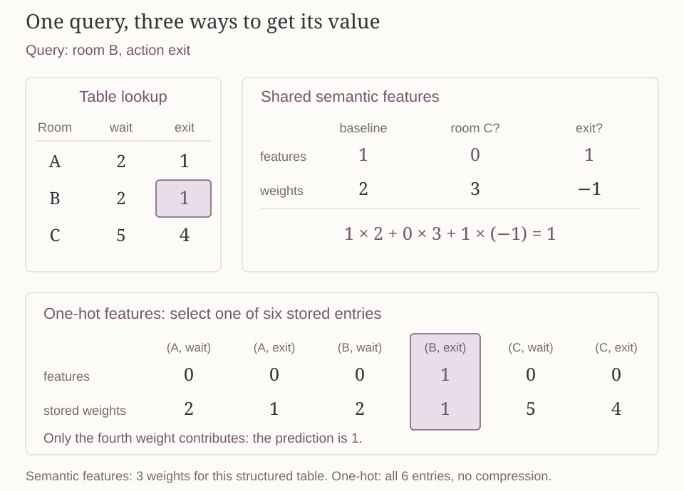{#fig-features-and-table-lookup fig-alt="Query room B and action exit. Table lookup retrieves 1. Semantic features 1, 0, 1 with weights 2, 3, minus 1 produce 1. One-hot features select the fourth entry of weights 2, 1, 2, 1, 5, 4, also giving 1."}

With $d<N$, a fixed linear model cannot represent every possible $N$-entry table: there are fewer adjustable coefficients than independent table entries. The reduced storage comes with restrictions on the possible predictions. The matrix formulation below makes this restriction explicit.

### Sharing can help and can introduce conflicts

In the three-feature room example, rooms A and B have identical features for the same action. Consequently,

$$
\phi(x,a)=\phi(\widetilde x,\widetilde a)
\quad\Longrightarrow\quad
\widehat Q_t(x,a)=\widehat Q_t(\widetilde x,\widetilde a)
\quad\text{for every }w_t.
$$

Changing a shared weight changes several predictions together. This can transfer information between related inputs. It also prevents fitting targets that distinguish inputs the features identify. For example, targets $1$ and $3$ at $(\mathrm A,\mathrm{exit})$ and $(\mathrm B,\mathrm{exit})$ cannot both be represented by this feature map. We must therefore distinguish choosing the function family from choosing the best weights within that family.

## Fitting fixed targets by least squares {#least-squares}

For now, fix one stage and omit $t$. Suppose we are given $n$ design pairs and target labels $(x_i,a_i,y_i)$, for $i=1,\ldots,n$. The index $i$ identifies a data row; different rows can share a state, an action, or even the entire pair. It does not enumerate a Cartesian product. Write $\phi_i=\phi(x_i,a_i)\in\mathbb R^d$.

During this fitting problem, the inputs, features, and targets are fixed. We adjust $w$ to change the predictions $\phi_i^\top w$. The targets are simply the numbers to be fitted; they need not be optimal values.

### Objective, matrix form, and normal equations

Shared features may prevent us from matching every target exactly, so we need a rule for choosing a compromise. We use the sum of squared prediction errors. The data may also leave multiple weight vectors equally good; an optional quadratic weight penalty expresses a preference for smaller coefficients. It trades fitting accuracy against coefficient size and gives a unique minimizer when the penalty strength is positive, as shown below. The combined objective is

$$
L(w)=\sum_{i=1}^{n}(\phi_i^\top w-y_i)^2+\lambda\|w\|_2^2,
\qquad \lambda\geq0,
$$ {#eq-ridge-objective}

where $\|w\|_2^2=\sum_{j=1}^dw_j^2$. The first term is the **squared fit error** on the supplied data. The second is a **weight penalty**, which charges for large coefficients. Our convention uses the sum of squared errors, rather than their average; the numerical meaning of $\lambda$ depends on this convention. The case $\lambda=0$ is ordinary least squares (OLS); $\lambda>0$ is ridge regression.

Stack the transposed feature vectors into the rows of the design matrix:

$$
\Phi=\begin{bmatrix}\phi_1^\top\\\vdots\\\phi_n^\top\end{bmatrix}\in\mathbb R^{n\times d},
\qquad y=(y_1,\ldots,y_n)^\top\in\mathbb R^n.
$$

Rows correspond to data pairs and columns to feature coordinates. The vector $\Phi w$ contains all $n$ predictions, and $\Phi w-y$ contains prediction-minus-target residuals. Equation @eq-ridge-objective becomes

$$
\begin{aligned}
L(w)&=\|\Phi w-y\|_2^2+\lambda\|w\|_2^2\\
&=w^\top\Phi^\top\Phi w-2w^\top\Phi^\top y+y^\top y+\lambda w^\top w.
\end{aligned}
$$

Since $\Phi^\top\Phi$ is symmetric, differentiation gives

$$
\nabla L(w)=2\Phi^\top\Phi w-2\Phi^\top y+2\lambda w.
$$

Setting the gradient to zero gives the **normal equations**:

$$
(\Phi^\top\Phi+\lambda I_d)\widehat w=\Phi^\top y,
$$ {#eq-normal-equations}

where $I_d$ is the $d\times d$ identity matrix.

A zero gradient is sufficient here, not just necessary. For any solution $\widehat w$ and any other vector $w$, expand the difference of the two objectives:

$$
\begin{aligned}
L(w)-L(\widehat w)
={}&\|\Phi(w-\widehat w)\|_2^2+\lambda\|w-\widehat w\|_2^2\\
&+2(w-\widehat w)^\top
[\Phi^\top(\Phi\widehat w-y)+\lambda\widehat w].
\end{aligned}
$$

The normal equations make the bracket zero. The remaining terms are nonnegative, so $L(w)\geq L(\widehat w)$ for every $w$: the solution is a global minimizer.

### When are the weights unique?

Define

$$
\Lambda=\Phi^\top\Phi+\lambda I_d
=\sum_{i=1}^n\phi_i\phi_i^\top+\lambda I_d.
$$

For $\lambda>0$ and any nonzero vector $v\in\mathbb R^d$,

$$
v^\top\Lambda v=\|\Phi v\|_2^2+\lambda\|v\|_2^2>0.
$$

Thus $\Lambda$ is positive definite. If $\Lambda v=0$, the displayed expression would be zero, forcing $v=0$; hence $\Lambda$ is invertible. The unique fitted weights are

$$
\widehat w=\Lambda^{-1}\Phi^\top y
=\Lambda^{-1}\sum_{i=1}^n\phi_i y_i.
$$ {#eq-ridge-solution}

When $\lambda=0$, this inverse formula requires $\Phi$ to have full column rank: its columns must be linearly independent. Equivalently, $\Phi v=0$ must imply $v=0$. Without full column rank, OLS still has a minimizer, but its weights need not be unique. The fitted prediction vector on the design rows is unique, because it is the closest point to $y$ in the column space of $\Phi$, as explained below. Different minimizing weights can disagree at other inputs.

A numerical implementation normally solves the linear system rather than explicitly constructing an inverse. Ridge ensures uniqueness, but neither uniqueness nor invertibility establishes that the predictions are accurate.

### A complete example: fitting error versus weight penalty

Take two data rows and one feature ($n=2$, $d=1$), with $\phi_1=\phi_2=1$ and labels $y_1=1$, $y_2=3$. The subscripts on $\phi_i$ identify the data rows. Both predictions equal the same scalar $w$. Without regularization,

$$
L(w)=(w-1)^2+(w-3)^2,
\qquad
\widehat w=\frac{1\cdot1+1\cdot3}{1^2+1^2}=2.
$$

The residuals are $2-1=1$ and $2-3=-1$, giving squared fit error $1^2+(-1)^2=2$.

Now use $\lambda=2$. The normal equation is $(2+1^2+1^2)\widehat w=1+3$, so $\widehat w=1$. To compare this solution with $w=2$, evaluate both using the **same penalized objective**:

| Weights | Squared fit error | Weight penalty | Total $L(w)$ |
|:--|:--|:--|--:|
| $w=2$ | $(2-1)^2+(2-3)^2=2$ | $2\cdot2^2=8$ | $10$ |
| $w=1$ | $(1-1)^2+(1-3)^2=4$ | $2\cdot1^2=2$ | $6$ |

Ridge increases the fitting error by $2$ but decreases the penalty by $6$. Its objective therefore decreases by $4$. This is the intended tradeoff in its objective; it is not a claim that ridge always improves prediction accuracy on new data.

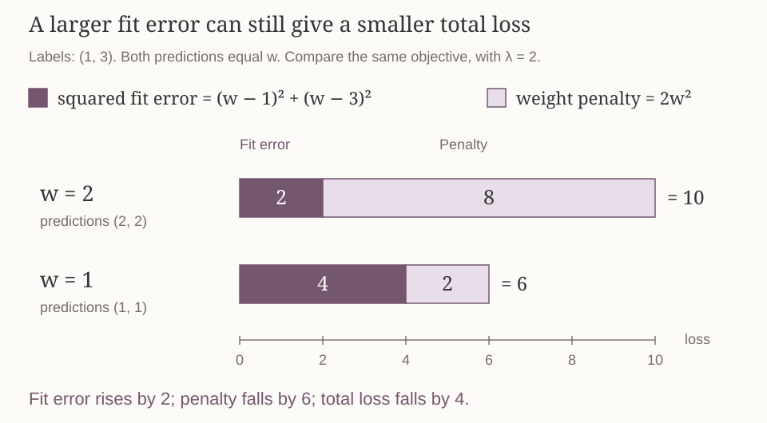{#fig-ridge-fit-and-penalty fig-alt="With labels 1 and 3 and lambda 2, weight 2 has squared fit error 2 and penalty 8; weight 1 has fit error 4 and penalty 2. The stacked total losses are 10 and 6."}

## Why ordinary least squares is a projection {#projection}

The two-label example could not match both targets. A geometric view explains why some error is unavoidable with these features: they restrict the possible prediction vectors, and ordinary least squares chooses the closest one to the target vector.

The geometry takes place in **prediction space**. A point $\Phi w\in\mathbb R^n$ records one prediction for each of the $n$ data rows. Its coordinate $i$ is the prediction at sample $i$, not a state coordinate or a weight.

In the preceding two-label example,

$$
\Phi=\begin{pmatrix}1\\1\end{pmatrix},\qquad
\Phi w=(w,w)^\top,\qquad y=(1,3)^\top.
$$

In a two-dimensional picture, the horizontal axis is the prediction for sample 1 and the vertical axis is the prediction for sample 2. Possible prediction vectors lie on the diagonal line: $w=1,2,3$ give $(1,1)$, $(2,2)$, and $(3,3)$. The target point $(1,3)$ lies off that line.

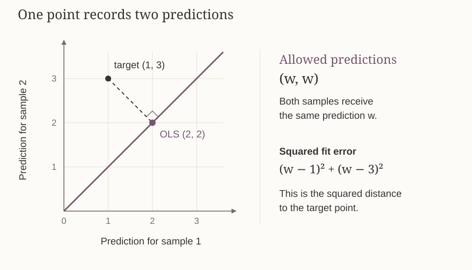{#fig-ls-projection fig-alt="Horizontal axis: prediction for sample 1. Vertical axis: prediction for sample 2. Allowed prediction points lie on the line (w,w). The target is (1,3), and its perpendicular projection is the OLS prediction (2,2)."}

For $\lambda=0$, the loss is

$$
(w-1)^2+(w-3)^2=\|(w,w)^\top-(1,3)^\top\|_2^2.
$$

It is the squared Euclidean distance from a candidate prediction point to the target. Minimizing it chooses the nearest point on the line, namely $(2,2)$. The displacement from the target to this fitted point is $(1,-1)$, perpendicular to the line's direction $(1,1)$ because

$$
(1,1)\cdot(1,-1)=0.
$$

The same statement holds for general features. The possible prediction vectors form the column space

$$
\{\Phi w:w\in\mathbb R^d\}\subseteq\mathbb R^n.
$$

With $\lambda=0$, the normal equations say

$$
\Phi^\top(\Phi\widehat w-y)=0.
$$

Thus the residual is orthogonal to every feature column and hence to every vector in their span. For any other candidate $\Phi w$, the difference $\Phi w-\Phi\widehat w$ belongs to this span. Expanding the squared distance and using orthogonality gives

$$
\|\Phi w-y\|_2^2
=\|\Phi\widehat w-y\|_2^2
+\|\Phi w-\Phi\widehat w\|_2^2.
$$

Every other prediction vector is at least as far from $y$, with equality only when it equals $\Phi\widehat w$. This is the orthogonal projection interpretation of OLS.

Ridge also charges for coefficient size. In our example it selects $(1,1)$ when $\lambda=2$, although $(2,2)$ is closer to $y$. Ridge is therefore not the ordinary Euclidean projection of $y$ onto the original prediction space.

## What zero training error does not establish {#coverage}

The projection result concerns only the supplied data rows. A value function may also be queried at other inputs, so we need to understand what a good fit on these rows tells us about predictions elsewhere.

We now change examples and coordinate systems. Let the numerical states be $x\in\{0,1,2\}$, with one fixed action, and use $\phi(x)=(1,x)^\top$. A prediction has the form

$$
\widehat q(x)=w_1+w_2x.
$$

Here $w_1$ is the intercept and $w_2$ the slope; these subscripts are coefficient indices, not decision stages. In a graph of this function, the horizontal axis is the input $x$ and the vertical axis is a target or prediction value.

Suppose only $(x,y)=(0,0)$ and $(1,1)$ are supplied for fitting, with $\lambda=0$. The objective is

$$
w_1^2+(w_1+w_2-1)^2.
$$

Both terms can be zero: $w_1=0$ and $w_2=1$. The fitted rule is $\widehat q(x)=x$, giving prediction $2$ at $x=2$. This value was inferred from the chosen function family; no target at $2$ was supplied.

To see what the data cannot establish, construct another possible target function,

$$
f(x)=x+2x(x-1).
$$

The added term is zero at both observed inputs, so this function fits exactly the same data. But at the omitted state it gives $f(2)=2+2\cdot2\cdot(2-1)=6$.

| State | Used in fitting? | Fitted prediction $\widehat q(x)$ | Possible target $f(x)$ |
|--:|:--|--:|--:|
| 0 | yes | 0 | 0 |
| 1 | yes | 1 | 1 |
| 2 | no | 2 | 6 |

If the actual target were $f$, the absolute error at $2$ would be $4$, and its squared error would be $16$, despite zero training error. We constructed $f$ to show a possibility the data cannot rule out; we did not infer that it is the true target.

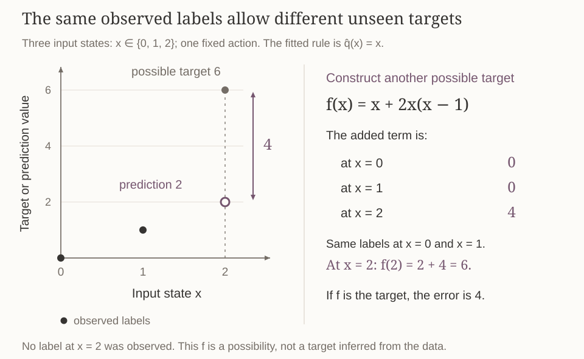{#fig-observed-fit-and-unseen-target fig-alt="Input state is the horizontal axis and target or prediction value is the vertical axis. Observed points are 0,0 and 1,1. At unobserved input 2, the fitted prediction is 2 and the possible target is 6. The added term 2x(x minus 1) is zero at observed inputs and four at input 2."}

If we additionally know that the true target has the form $w_1+w_2x$, the two noiseless labels at distinct inputs do determine it, and the prediction at $2$ is correct. The counterexample permits the true target to fall outside this family. It establishes that zero training error **alone** does not verify the representation assumption or guarantee accuracy at omitted inputs.

## Least-squares value iteration with an exact model {#lsvi}

So far, targets were supplied as data. In DP, optimal values are unknown, but the next-stage estimate provides a way to construct useful targets. Initialize $\widehat V_{H+1}=g$ exactly, then process $t=H,H-1,\ldots,1$.

At stage $t$, choose $n_t$ feasible **design pairs** $(x_{ti},a_{ti})$, $i=1,\ldots,n_t$. Here $t$ is the decision stage and $i$ indexes a chosen pair. These inputs need not form a trajectory. A known model lets us calculate an expectation at any selected feasible pair.

First, use the already constructed next-stage function to compute

$$
y_{ti}=r(x_{ti},a_{ti})+
\sum_{x'}\mathcal P(x'\mid x_{ti},a_{ti})\widehat V_{t+1}(x').
$$ {#eq-lsvi-target}

The transition average is exact, but its input $\widehat V_{t+1}$ may be approximate. At the last decision, the input is the exact terminal function $g$.

Next, write $\phi_{ti}=\phi(x_{ti},a_{ti})$ and fit one weight vector:

$$
w_t\in\operatorname*{argmin}_{w\in\mathbb R^d}
\left\{\sum_{i=1}^{n_t}(\phi_{ti}^\top w-y_{ti})^2+\lambda\|w\|_2^2\right\}.
$$

The targets are held fixed while varying the current-stage weights. They were constructed from $\widehat V_{t+1}$, not from the $w$ being optimized. The corresponding normal equations are

$$
\Lambda_t w_t=\sum_{i=1}^{n_t}\phi_{ti}y_{ti},
\qquad
\Lambda_t=\lambda I_d+\sum_{i=1}^{n_t}\phi_{ti}\phi_{ti}^\top.
$$

Finally, define predictions at every feasible pair and choose actions:

$$
\begin{aligned}
\widehat Q_t(x,a)&=\phi(x,a)^\top w_t,\\
\widehat V_t(x)&=\max_{a\in\mathcal A(x)}\widehat Q_t(x,a),\\
\widehat\pi_t(x)&\in\operatorname*{argmax}_{a\in\mathcal A(x)}\widehat Q_t(x,a).
\end{aligned}
$$ {#eq-lsvi-output}

A fixed deterministic tie rule selects one maximizing action. The maximum is a number used in the preceding stage's targets; the argmax selects an action to execute. The output policy is the entire sequence $\widehat\pi=(\widehat\pi_1,\ldots,\widehat\pi_H)$.

Write $y_t=(y_{t1},\ldots,y_{t n_t})^\top$ for the vector of targets at stage $t$. For two stages, the dependency is

$$
g\longrightarrow y_2\longrightarrow w_2\longrightarrow\widehat V_2
\longrightarrow y_1\longrightarrow w_1\longrightarrow\widehat V_1.
$$

Each stage is processed once, after the next stage has been completed. Although the name contains “value iteration,” this finite-horizon algorithm is a backward sequence of regressions, not an iteration toward an infinite-horizon fixed point. It stores $H$ weight vectors of length $d$. Computing expectations, solving the regressions, and maximizing over actions still require work; reducing parameter count does not make these tasks automatically cheap.

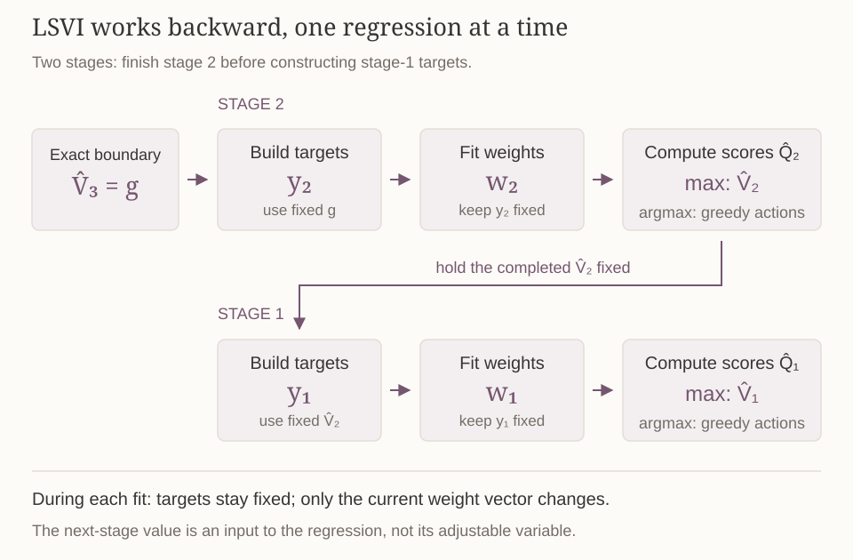{#fig-lsvi-backward-flow fig-alt="Starting from terminal g, stage 2 constructs targets, fits weights, and maximizes its fitted action values. The resulting stage-2 value function supplies stage-1 targets, followed by stage-1 fitting and maximization. No arrow loops back to refit a completed stage."}

## A complete two-stage job example {#job}

We retain the job from Lecture 5. Progress is $x\in\{0,1,2\}$, the initial state is $0$, and $H=2$. Waiting, denoted by action $q$, gives reward $0$ and leaves progress unchanged. Working, denoted by action $w$, is feasible at progress $0$ or $1$, costs one unit immediately, and advances progress by one with probability $0.8$; otherwise progress stays unchanged. At progress $2$, only waiting is feasible. At stage $3$, the terminal payoff is

$$
g(0)=g(1)=0,\qquad g(2)=10.
$$

The completion bonus is paid once at the terminal stage. Work costs are paid whenever work is attempted. The action label $w$ means work; a vector $w_t$ or component $w_{t,j}$ denotes fitted weights.

### Compress five action values into three groups

To make the effect of sharing visible, we deliberately assign the same features to progress $0$ and $1$ for each action. This tests what happens when the representation discards a distinction that may matter for the remaining return. Use the same three features at both stages:

| Pair | Feature vector | Fitted prediction |
|:--|:--|:--|
| $(0,q)$ | $(1,0,0)^\top$ | $w_{t,1}$ |
| $(0,w)$ | $(0,1,0)^\top$ | $w_{t,2}$ |
| $(1,q)$ | $(1,0,0)^\top$ | $w_{t,1}$ |
| $(1,w)$ | $(0,1,0)^\top$ | $w_{t,2}$ |
| $(2,q)$ | $(0,0,1)^\top$ | $w_{t,3}$ |

The groups are unfinished wait, unfinished work, and completed wait. The physical states remain distinct in the MDP; only the value representation merges their predictions.

Fit all five pairs once at each stage, with equal weight and $\lambda=0$. Every feasible pair is included, so any failure to preserve these targets comes from the feature restriction rather than missing inputs. In the displayed row order,

$$
\Phi=\begin{pmatrix}
1&0&0\\0&1&0\\1&0&0\\0&1&0\\0&0&1
\end{pmatrix},\qquad
\Phi^\top\Phi=\begin{pmatrix}2&0&0\\0&2&0\\0&0&1\end{pmatrix}.
$$

The diagonal entries count rows in each group. Different feature columns are never active in the same row, so the off-diagonal entries are zero. If $y_{ti}$ is the target of row $i$ at stage $t$, the normal equations give

$$
\begin{pmatrix}2w_{t,1}\\2w_{t,2}\\w_{t,3}\end{pmatrix}
=\begin{pmatrix}y_{t1}+y_{t3}\\y_{t2}+y_{t4}\\y_{t5}\end{pmatrix}.
$$

Thus each fitted score is its group's target average:

$$
w_{t,1}=\frac{y_{t1}+y_{t3}}2,
\qquad
w_{t,2}=\frac{y_{t2}+y_{t4}}2,
\qquad
w_{t,3}=y_{t5}.
$$ {#eq-group-average}

For example, the first group minimizes $(w_{t,1}-y_{t1})^2+(w_{t,1}-y_{t3})^2$. Its derivative is $2(w_{t,1}-y_{t1})+2(w_{t,1}-y_{t3})$, which vanishes at their average. The matrix calculation performs this calculation for all groups together. Simple averaging follows from these group features, equal data weights, and zero regularization; it is not a formula for arbitrary features.

### Stage 2: construct targets, fit, and maximize

The next stage is terminal, so each stage-2 target is an exact optimal action value:

$$
y_2(x,a)=r(x,a)+\sum_{x'}\mathcal P(x'\mid x,a)g(x')=Q_2^*(x,a).
$$

| Pair | Target calculation | Target |
|:--|:--|--:|
| $(0,q)$ | $0+g(0)$ | $0$ |
| $(0,w)$ | $-1+0.8g(1)+0.2g(0)$ | $-1$ |
| $(1,q)$ | $0+g(1)$ | $0$ |
| $(1,w)$ | $-1+0.8g(2)+0.2g(1)$ | $7$ |
| $(2,q)$ | $0+g(2)$ | $10$ |

Averaging within groups yields

$$
w_2=\begin{pmatrix}(0+0)/2\\(-1+7)/2\\10\end{pmatrix}
=\begin{pmatrix}0\\3\\10\end{pmatrix}.
$$

The two work targets disagree: one is $-1$, the other $7$, but their shared prediction must be $3$. Full data coverage cannot remove this representation error.

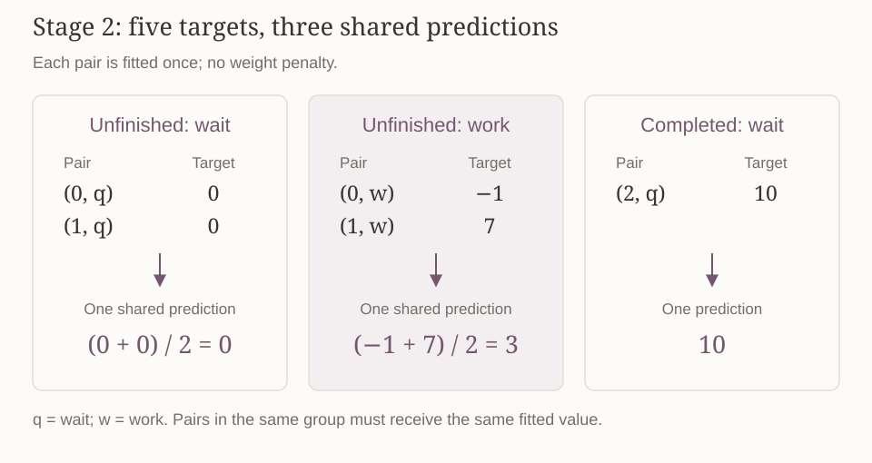{#fig-job-shared-fit fig-alt="Three groups of job state-action pairs. Unfinished wait combines targets 0 and 0 into prediction 0; unfinished work combines targets -1 and 7 into prediction 3; completed wait retains target 10 as prediction 10."}

| Progress | Fitted wait score | Fitted work score | $\widehat V_2$ | $\widehat\pi_2$ |
|--:|--:|--:|--:|:--|
| 0 | 0 | 3 | 3 | work |
| 1 | 0 | 3 | 3 | work |
| 2 | 10 | infeasible | 10 | wait |

At progress $0$ with one period left, working cannot complete the job, so its true value is $-1$ and waiting is optimal. The representation changes that decision by giving both work inputs the same score. At progress $1$, work remains preferred, although its fitted score is smaller than its true value. The model calculations were exact; the features erased a distinction relevant to the action choice.

### Stage 1: use the fitted next-stage values

We keep the same model and features, fit all five pairs once, and use $\lambda=0$. Stage 2 has supplied $\widehat V_2=(3,3,10)^\top$, in state order $(0,1,2)$. The stage-1 targets are

$$
y_1(x,a)=r(x,a)+\sum_{x'}\mathcal P(x'\mid x,a)\widehat V_2(x').
$$

Each target uses the fitted stage-2 values. Substituting these values into the transition average gives:

| Pair | Target calculation | Target |
|:--|:--|--:|
| $(0,q)$ | $0+3$ | $3$ |
| $(0,w)$ | $-1+0.8(3)+0.2(3)$ | $2$ |
| $(1,q)$ | $0+3$ | $3$ |
| $(1,w)$ | $-1+0.8(10)+0.2(3)$ | $7.6$ |
| $(2,q)$ | $0+10$ | $10$ |

The transition average is still exact, but it averages approximate next-stage values. Applying the group-average formula @eq-group-average gives

$$
w_1=\begin{pmatrix}(3+3)/2\\(2+7.6)/2\\10\end{pmatrix}
=\begin{pmatrix}3\\4.8\\10\end{pmatrix}.
$$

At progress $0$ or $1$, the fitted work score $4.8$ exceeds the wait score $3$; at progress $2$, waiting is the only action. Hence $\widehat V_1=(4.8,4.8,10)^\top$. The complete fitted policy works whenever unfinished at both decision stages.

### Three different values at the initial state

The fitted prediction is $\widehat V_1(0)=4.8$. To calculate the policy's **actual expected return**, we must evaluate its real rewards and transitions. Starting from $0$, its rule attempts work in both periods. Two successes, with probability $0.8^2=0.64$, give total return $-2+10=8$. Every other outcome gives total return $-2$. Therefore

$$
V_1^{\widehat\pi}(0)=0.64(8)+0.36(-2)=4.4.
$$

For comparison, exact DP gives $V_2^*=(0,7,10)^\top$. At the initial state, the two exact action scores are

$$
\begin{aligned}
Q_1^*(0,q)&=0+V_2^*(0)=0,\\
Q_1^*(0,w)&=-1+0.8V_2^*(1)+0.2V_2^*(0)=4.6.
\end{aligned}
$$

The optimal policy works first. If the attempt succeeds, it works again; if it fails, it waits because completion is then impossible. Thus

$$
\underbrace{\widehat V_1(0)=4.8}_{\text{fitted prediction}},\qquad
\underbrace{V_1^*(0)=4.6}_{\text{optimal return}},\qquad
\underbrace{V_1^{\widehat\pi}(0)=4.4}_{\text{fitted policy's return}}.
$$

The fitted policy loses $0.2$ in expected return: with probability $0.2$, it pays for a useless second work attempt after the first fails. Its fitted prediction is not its policy return, and need not lie below the optimal return.

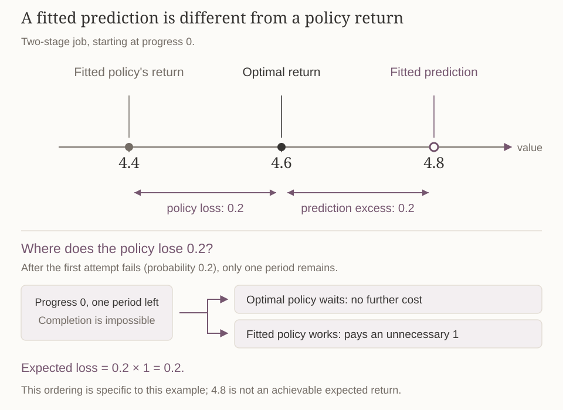{#fig-fitted-values-and-policy-return fig-alt="On a common value axis, the fitted policy has actual return 4.4, the optimal return is 4.6, and the fitted prediction is 4.8. The policy loss is 0.2; the prediction exceeds the optimal return by 0.2."}

## When LSVI reduces to exact tabular DP {#tabular-recovery}

The earlier one-hot construction recovered table lookup as a representation. We now check that it also recovers the entire backward-DP calculation when used in LSVI.

Replace the job's three grouped features by one coordinate for each of its five feasible pairs. More generally, use one-hot features for all $N$ feasible pairs, fit every pair once in the same row and coordinate order, and set $\lambda=0$. Then $\Phi=I_N$, so

$$
w_t=(I_N^\top I_N)^{-1}I_N^\top y_t=y_t.
$$

Every computed target is preserved exactly. At stage $H$, the targets use $g$ and equal $Q_H^*$. Consequently $\widehat V_H=V_H^*$. Applying the same argument backward proves $\widehat Q_t=Q_t^*$ and $\widehat V_t=V_t^*$ at every stage. The feature dimension is now $N$, so there is no parameter saving.

All parts of this statement matter: one coordinate per pair, full coverage, exact targets, and no ridge penalty. For example, with the same identity design but $\lambda>0$, the fitted vector would be $y_t/(1+\lambda)$, which generally changes the targets.

## How fitting errors propagate through LSVI {#error-bounds}

One-hot features with full coverage recover exact DP, but the shared-feature job example produced prediction $4.8$, optimal return $4.6$, and actual policy return $4.4$ at the initial state. We now want a quantitative guarantee: **if each stage fits its targets approximately, how far can the resulting values and policy be from optimal?** This section bounds value error; the next section uses the same analysis to bound policy loss.

An earlier-stage prediction can be inaccurate for two reasons. Its target already uses an approximate next-stage value, and the current regression may introduce another mismatch when fitting that target. We need to separate the error inherited from the next stage from the mismatch introduced by the current fit. The latter is what the Bellman-fit residual measures.

First, extend the target definition to **every** feasible pair, including pairs not selected for regression:

$$
y_t(x,a)=r(x,a)+\sum_{x'}\mathcal P(x'\mid x,a)\widehat V_{t+1}(x').
$$

This target is determined by the known model and the fitted next-stage function. We can therefore compare $\widehat Q_t(x,a)$ with $y_t(x,a)$ without first knowing $Q_t^*(x,a)$. To obtain a guarantee across states, we need this comparison at every feasible pair: action maximization compares all feasible actions, and backups at earlier stages use the resulting values at successor states.

The **uniform Bellman-fit residual** measures the largest such discrepancy:

$$
\varepsilon_t=\max_{x\in\mathcal X,\,a\in\mathcal A(x)}
|\widehat Q_t(x,a)-y_t(x,a)|.
$$ {#eq-uniform-residual}

“Uniform” means the same error bound applies to all feasible pairs. The residual is an absolute error, not a squared loss, and compares the fitted score with the backup of its own approximate next-stage value. At earlier stages that target need not equal $Q_t^*$.

With this finite, known model, enumerating every pair would compute $\varepsilon_t$ exactly, but may be expensive. If we rely only on the regression data instead, a small training loss does not by itself establish a small uniform residual.

For the full-data stage-2 job fit, the five target values are $(0,-1,0,7,10)^\top$ and predictions are $(0,3,0,3,10)^\top$. Their absolute differences are $(0,4,0,4,0)^\top$, so $\varepsilon_2=4$. At stage 1, the two work pairs have absolute residuals $|4.8-2|=2.8$ and $|4.8-7.6|=2.8$; the other three pairs are fitted exactly. The five absolute residuals are therefore $(0,2.8,0,2.8,0)^\top$, giving $\varepsilon_1=2.8$.

### Training loss alone does not certify the residual

The data-fit term in the regression objective only includes selected rows. The residual $\varepsilon_t$ also includes every omitted pair. The following variation of the job example shows why this distinction matters.

For a separate counterexample, change the job's stage-2 data and refit using only $(0,q)$, $(0,w)$, and $(2,q)$, once each with $\lambda=0$. Their three feature rows form $\Phi=I_3$, their targets are $(0,-1,10)^\top$, and the unique fit is $w_2=(0,-1,10)^\top$. Every training label is fitted exactly.

At the omitted pair $(1,w)$, however, the feature is identical to that of $(0,w)$, so the prediction is $-1$. Its exact target is $-1+0.8(10)+0.2(0)=7$. The absolute residual is $8$. This identity matrix indexes three **feature groups**; it is not the five-coordinate tabular construction above. Full column rank ensures a unique solution on the chosen features, not accuracy at omitted pairs.

If every feasible pair is included at least once, the sum of squared fitting residuals is at least $\varepsilon_t^2$: it contains a term attaining the largest absolute residual, squared. Its square root then supplies a possibly loose uniform bound. In the example above, omitted pairs are why the training sum does not control the uniform residual. Covering every pair still does not ensure a small residual when the features cannot represent the targets.

### Propagating a residual backward

Define the worst state-value error at stage $t$ by

$$
e_t=\max_x|\widehat V_t(x)-V_t^*(x)|.
$$

At every feasible pair, insert its own Bellman target between the fitted and optimal action values. The first difference below is the current fit's residual; the second comes from using approximate next-stage values in that target:

$$
\begin{aligned}
|\widehat Q_t(x,a)-Q_t^*(x,a)|
&\leq|\widehat Q_t(x,a)-y_t(x,a)|+|y_t(x,a)-Q_t^*(x,a)|\\
&\leq\varepsilon_t+
\left|\sum_{x'}\mathcal P(x'\mid x,a)
[\widehat V_{t+1}(x')-V_{t+1}^*(x')]\right|\\
&\leq\varepsilon_t+
\sum_{x'}\mathcal P(x'\mid x,a)
|\widehat V_{t+1}(x')-V_{t+1}^*(x')|\\
&\leq\varepsilon_t+
\sum_{x'}\mathcal P(x'\mid x,a)e_{t+1}
=\varepsilon_t+e_{t+1}.
\end{aligned}
$$

The first step is the triangle inequality. Rewards cancel in the difference between the two targets. The remaining steps use nonnegative probabilities, the uniform bound on the next-stage error, and probabilities summing to one.

For two sets of action scores, $|\max_a u_a-\max_a v_a|\leq\max_a|u_a-v_a|$. To recall why, set $D=\max_a|u_a-v_a|$. Every $u_a\leq v_a+D\leq\max_b v_b+D$, so $\max_a u_a\leq\max_b v_b+D$; exchanging the two sets gives the other direction. The maximizing actions need not coincide.

Applying this inequality to the action values gives, for every state,

$$
|\widehat V_t(x)-V_t^*(x)|
\leq\max_a|\widehat Q_t(x,a)-Q_t^*(x,a)|
\leq\varepsilon_t+e_{t+1}.
$$

The right side does not depend on $x$, so $e_t\leq\varepsilon_t+e_{t+1}$. Both terminal functions equal $g$, hence $e_{H+1}=0$. Repeated substitution yields the following result.

::: {#thm-lsvi-value-error}
## Finite-horizon value error

With the exact terminal boundary and residuals defined by @eq-uniform-residual,

$$
\max_x|\widehat V_t(x)-V_t^*(x)|
\leq\sum_{s=t}^{H}\varepsilon_s.
$$
:::

This finite sum follows from backward induction, without a discount-contraction argument. It is conditional on uniform residual control; a loss computed only on selected pairs does not establish that control without further justification.

Returning to the full-data fit in the worked job example, $\varepsilon_1=2.8$ and $\varepsilon_2=4$. The stage-1 bound is therefore $2.8+4=6.8$, which is valid but conservative.

To compare with the actual error, exact DP gives $V_1^*(1)=\max\{-1+0.8(10)+0.2(7),7\}=8.4$ and $V_1^*(2)=10$. Together with $V_1^*(0)=4.6$ and the fitted vector $(4.8,4.8,10)^\top$,

$$
e_1=\max\{|4.8-4.6|,\ |4.8-8.4|,\ |10-10|\}=3.6.
$$

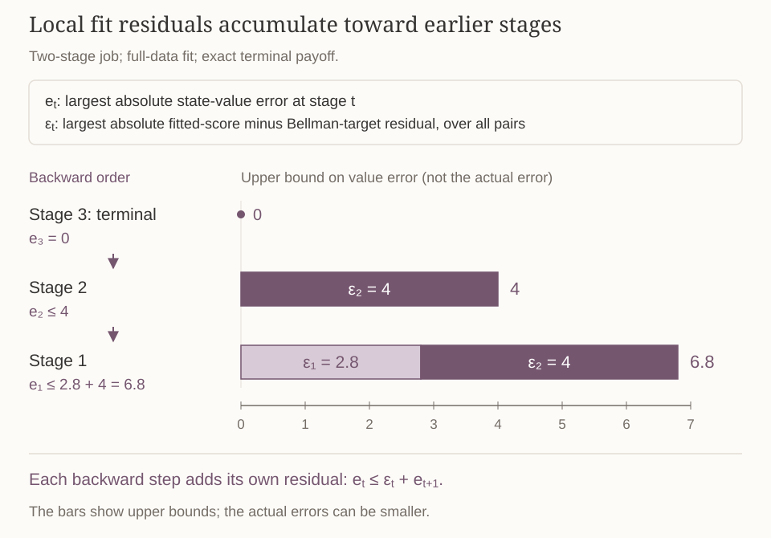{#fig-lsvi-error-propagation fig-alt="Terminal error e3 equals zero. The stage-2 residual epsilon2 equals 4, giving e2 at most 4. The stage-1 residual epsilon1 equals 2.8 adds to that bound, giving e1 at most 6.8."}

## Policy loss and the fitted prediction {#policy-loss}

The fitted scores select the stage-dependent policy $\widehat\pi$. The performance quantity we care about is $V_t^{\widehat\pi}$, its actual expected return. We already bounded the gap between the fitted prediction and the optimal return. We now bound its gap from the fitted policy's actual return, then combine the two comparisons to control policy loss.

::: {#thm-lsvi-policy-loss}
## Performance of the fitted greedy policy

Under the same exact terminal boundary and uniform residual bounds,

$$
0\leq V_t^*(x)-V_t^{\widehat\pi}(x)
\leq2\sum_{s=t}^{H}\varepsilon_s
\qquad\text{for every state }x.
$$
:::

::: {.proof}
Define $f_t=\max_x|\widehat V_t(x)-V_t^{\widehat\pi}(x)|$. At a fixed state, take $a=\widehat\pi_t(x)$. Greediness gives $\widehat V_t(x)=\widehat Q_t(x,a)$, while the policy Bellman equation gives

$$
V_t^{\widehat\pi}(x)=r(x,a)+\sum_{x'}\mathcal P(x'\mid x,a)V_{t+1}^{\widehat\pi}(x').
$$

Insert the target $y_t(x,a)$ to separate the current residual from the next-stage prediction error:

$$
\begin{aligned}
\widehat V_t(x)-V_t^{\widehat\pi}(x)
={}&\widehat Q_t(x,a)-y_t(x,a)\\
&+\sum_{x'}\mathcal P(x'\mid x,a)
[\widehat V_{t+1}(x')-V_{t+1}^{\widehat\pi}(x')].
\end{aligned}
$$

Taking absolute values and averaging the uniform next-stage bound gives

$$
\begin{aligned}
|\widehat V_t(x)-V_t^{\widehat\pi}(x)|
&\leq|\widehat Q_t(x,a)-y_t(x,a)|+
\sum_{x'}\mathcal P(x'\mid x,a)
|\widehat V_{t+1}(x')-V_{t+1}^{\widehat\pi}(x')|\\
&\leq\varepsilon_t+\sum_{x'}\mathcal P(x'\mid x,a)f_{t+1}
=\varepsilon_t+f_{t+1}.
\end{aligned}
$$

This bound holds at every state, so $f_t\leq\varepsilon_t+f_{t+1}$. Since $f_{H+1}=0$, backward induction gives $f_t\leq\sum_{s=t}^{H}\varepsilon_s$.

Now compare the optimal and actual policy returns through the fitted prediction:

$$
\begin{aligned}
V_t^*(x)-V_t^{\widehat\pi}(x)
&=[V_t^*(x)-\widehat V_t(x)]
+[\widehat V_t(x)-V_t^{\widehat\pi}(x)]\\
&\leq|V_t^*(x)-\widehat V_t(x)|
+|\widehat V_t(x)-V_t^{\widehat\pi}(x)|\\
&\leq2\sum_{s=t}^{H}\varepsilon_s.
\end{aligned}
$$

The first absolute difference is controlled by @thm-lsvi-value-error and the second by the recursion just proved. Nonnegativity follows because $V_t^*$ is optimal over all admissible policies. No ordering of the fitted prediction relative to either true return is assumed.
:::

## Bellman completeness: can a backup remain representable? {#bellman-completeness}

The error bounds say what follows **if** uniform residuals are small. To understand when an exact fit might be possible, we need a property of the model and representation together.

LSVI constructs targets from estimated next-stage values. Even if the optimal action values are representable, the targets formed from other estimates may leave the chosen function family. We therefore seek a property that keeps every such candidate's Bellman backup representable.

Take any next-stage parameter vector $w_{t+1}\in\mathbb R^d$. It defines the candidate next-stage value

$$
\widehat V_{t+1}(x')=\max_{b\in\mathcal A(x')}\phi(x',b)^\top w_{t+1}.
$$

Use that candidate in the exact Bellman backup. Bellman completeness asks whether the resulting target function can always be expressed using the same feature map.

::: {#def-bellman-completeness}
## Bellman completeness for the chosen features

For every next-stage vector $w_{t+1}\in\mathbb R^d$, there exists one current-stage vector $u_t\in\mathbb R^d$ such that

$$
r(x,a)+\sum_{x'}\mathcal P(x'\mid x,a)
\max_{b\in\mathcal A(x')}\phi(x',b)^\top w_{t+1}
=\phi(x,a)^\top u_t
$$

for every feasible pair $(x,a)$. This is the closure requirement at stages $t<H$. At the terminal boundary, the backup of the prescribed $g$ must also be representable.
:::

The quantifier order matters: **any next-stage weights, one current vector, all input pairs**. The vector $u_t$ may depend on the whole next-stage candidate, but it cannot be chosen separately for each input pair. The property is relative to the selected feature map and function family. It is stronger than saying that one particular optimal action-value function happens to be representable.

“Completeness” here means closure under a Bellman backup. It is different from the metric-space completeness used in Lecture 3's fixed-point theorem. It also does not assert that a regression algorithm automatically identifies the representing vector from any dataset.

The preceding error bounds did not require this property: they describe what follows from small uniform residuals. Completeness helps explain when zero representation error is possible.

### Why the coarse job features fail

At the last decision, the exact work targets are

$$
y_2(0,w)=-1,\qquad y_2(1,w)=7.
$$

Both inputs have feature $(0,1,0)^\top$, so any representing vector would have to satisfy $u_{2,2}=-1$ and $u_{2,2}=7$ simultaneously. Thus the terminal backup cannot be represented exactly.

To test the interior closure property, choose the next-stage candidate $w_2=(0,0,10)^\top$. This is a separate test of the function family; the worked LSVI fit above still has weights $(0,3,10)^\top$. Completeness must hold for every candidate, so we may test any weights in $\mathbb R^3$.

With the chosen candidate, both actions have score $0$ at unfinished states; at progress $2$, waiting has score $10$. Their maximum is exactly $g=(0,0,10)^\top$. The stage-1 backup of this valid candidate therefore produces the same incompatible work targets $-1$ and $7$. This is a counterexample to the “for every next-stage vector” requirement, using a candidate within the allowed function family.

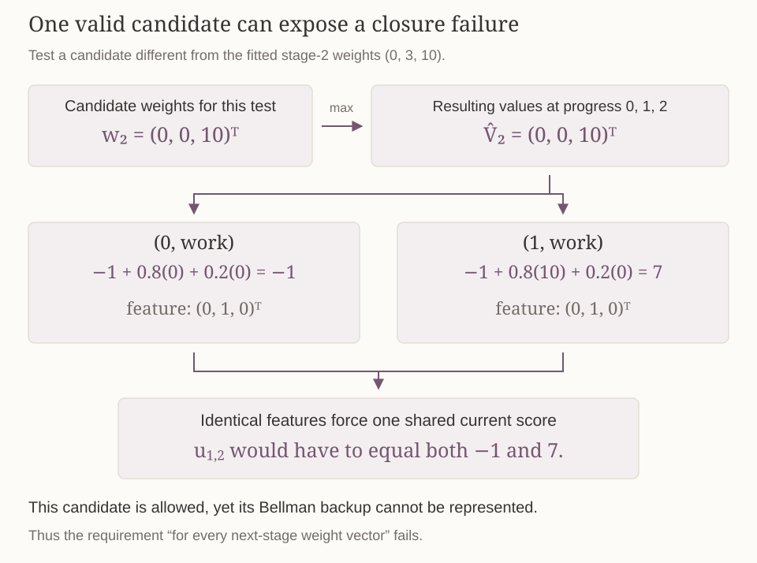{#fig-bellman-closure-job fig-alt="Allowed next-stage weights 0,0,10 give maximized state values 0,0,10. Their Bellman backup gives work target minus 1 at progress 0 and 7 at progress 1. Both work pairs have feature 0,1,0 and must share one current weight, which cannot equal both targets."}

If completeness and terminal compatibility hold, exact targets are representable at every step. With noiseless targets, zero regularization, and a full-column-rank design at every stage, least squares recovers the corresponding vector and exact backward DP. Without those fitting conditions, representability alone does not guarantee a zero residual.

## Linear MDPs provide a sufficient condition {#linear-mdp}

We now seek a condition on the rewards and transitions that guarantees the closure property just defined. This would give us a way to establish representability for every next-stage candidate without checking their backups one by one.

A linear **value approximator** is our choice of how to represent scores. A **linear MDP** makes an additional structural assumption about the environment itself, using the same known feature map. Suppose there are vectors $\theta\in\mathbb R^d$ and $\mu(x')\in\mathbb R^d$ for each successor state such that

$$
r(x,a)=\phi(x,a)^\top\theta,
\qquad
\mathcal P(x'\mid x,a)=\phi(x,a)^\top\mu(x').
$$ {#eq-linear-mdp}

The model coefficients determine rewards and probabilities. The resulting transition probabilities must be nonnegative and sum to one for every feasible current pair. Individual coordinate functions $\mu_j(x')$ need not themselves be probability distributions; the requirement applies to their feature-weighted combination.

For any next-stage value function $V:\mathcal X\to\mathbb R$, substitute @eq-linear-mdp into its target:

$$
\begin{aligned}
r(x,a)+\sum_{x'}\mathcal P(x'\mid x,a)V(x')
&=\phi(x,a)^\top\theta+
\sum_{x'}\phi(x,a)^\top\mu(x')V(x')\\
&=\phi(x,a)^\top
\left[\theta+\sum_{x'}\mu(x')V(x')\right].
\end{aligned}
$$

Denote the bracketed vector by $u$. It is independent of the current input $(x,a)$. The current feature vector can be factored outside the successor sum because it does not depend on $x'$. Thus every such target is representable, including targets formed from a maximized linear candidate and from the terminal function $g$. No linearity assumption on $V$ itself is needed.

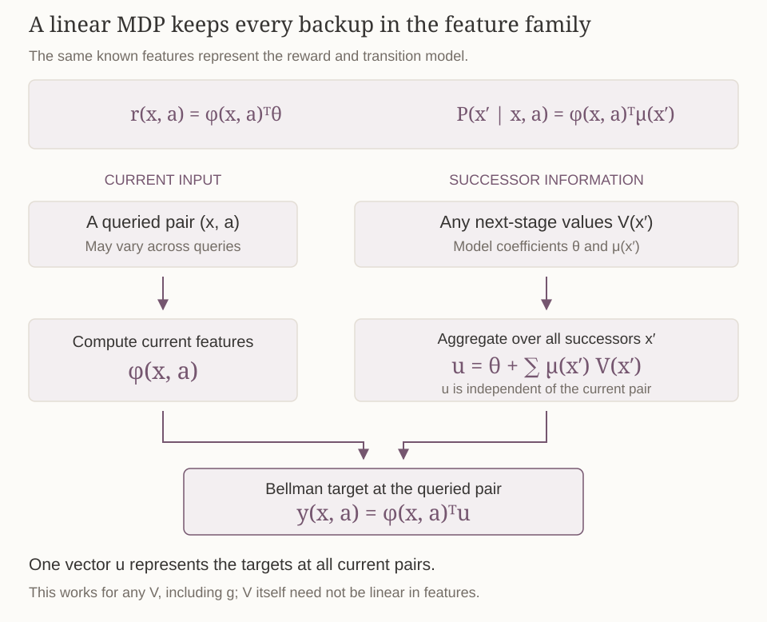{#fig-linear-mdp-backup fig-alt="For a linear MDP, aggregate theta plus the sum of mu of each successor times its value into a common vector u. Current pair features phi then produce the Bellman target phi transpose u. The vector u does not depend on the queried current pair, and the successor value function can be arbitrary."}

This proves that the same-feature linear MDP assumption is a **sufficient condition** for Bellman completeness and terminal compatibility. It does not prove a converse. Coverage, sampling noise, and ridge penalties can still introduce fitting error.

The job's coarse features do not satisfy this model assumption. They identify the two work pairs, but

$$
\mathcal P(2\mid0,w)=0,\qquad \mathcal P(2\mid1,w)=0.8.
$$

Identical features would force identical transition probabilities for successor $2$, a contradiction. Choosing a linear value model does not make an arbitrary MDP linear in those features.

## From model targets to samples and exploration {#samples}

Even with a known model, summing over all possible successors can be expensive. As in Lecture 5's online planning methods, a simulator offers an alternative by drawing individual transitions. In later learning problems, the reward and transition model may also be unknown. Generated or observed transitions can supply sampled targets for the same regression. We first examine what this substitution preserves, then consider how to choose actions when they also determine which data we collect.

So far, the model gave the exact target

$$
y=r(x,a)+\sum_{x'}\mathcal P(x'\mid x,a)\widehat V_{t+1}(x').
$$

With a fresh transition at this pair, we instead observe reward $R$ and next state $X'$. A sampled target is

$$
\widetilde y=R+\widehat V_{t+1}(X').
$$

For a fixed next-stage function independent of this fresh draw, conditional expectation gives

$$
\mathbb E[\widetilde y\mid x,a]
=\mathbb E[R\mid x,a]+\sum_{x'}\mathcal P(x'\mid x,a)\widehat V_{t+1}(x')=y.
$$

Reward and next state need not be independent of each other. The independence condition concerns the fresh draw and the already fitted next-stage function. Reusing data that helped construct that function requires further statistical analysis.

For stage 2 at job progress $1$, working produces sampled target $-1+10=9$ with probability $0.8$, or $-1+0=-1$ with probability $0.2$. Their mean is $0.8(9)+0.2(-1)=7$, the exact model target. A single observation produces $9$ or $-1$, not their average. Sampling therefore adds another source of error to approximation and incomplete coverage.

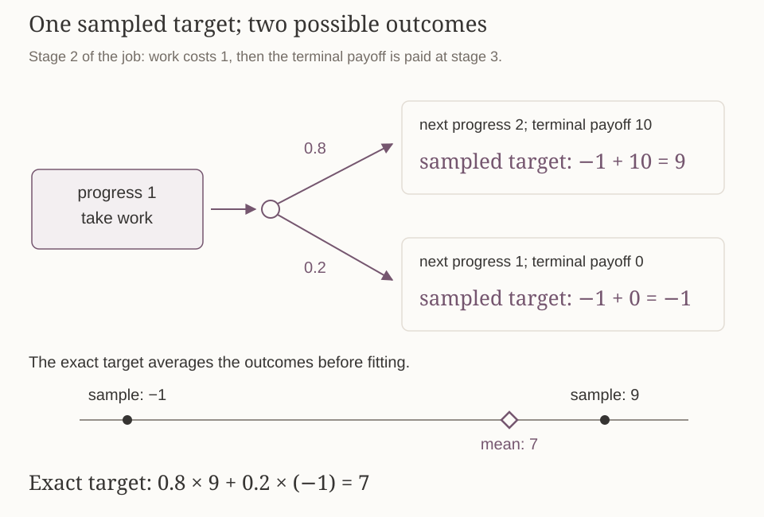{#fig-sampled-bellman-target fig-alt="At stage 2 and progress 1, work reaches progress 2 with probability 0.8 and gives sampled target 9, or remains at progress 1 with probability 0.2 and gives target minus 1. The mean target is 7."}

When actions determine which data are collected, an action with little evidence may be underestimated and then rarely selected again. An uncertainty bonus encourages trying such actions while still taking their estimated returns into account. LSVI with upper confidence bounds, called LSVI-UCB, uses scores of the form

$$
\underbrace{\phi(x,a)^\top w_t}_{\text{fitted estimate}}
+\underbrace{\beta\sqrt{\phi(x,a)^\top\Lambda_t^{-1}\phi(x,a)}}_{\text{uncertainty bonus}},
\qquad
\Lambda_t=\lambda I_d+\sum_i\phi_{ti}\phi_{ti}^\top,
$$

with $\lambda>0$ and bonus scale $\beta>0$. The collected stage-$t$ features determine the bonus at a queried pair. For example, with one-hot features, let $e_j$ have a one in coordinate $j$ and zeros elsewhere, and let $n_j$ count observations with this feature. Then $\Lambda_t$ is diagonal with entry $\lambda+n_j$, and the bonus at a pair with feature $e_j$ is $\beta/\sqrt{\lambda+n_j}$. With $\lambda$ and $\beta$ fixed, more observations of that coordinate reduce its bonus.

An action with a lower current estimate may receive a larger total score because its uncertainty is greater. The environment does not pay this bonus; it changes the algorithm's decision rule.

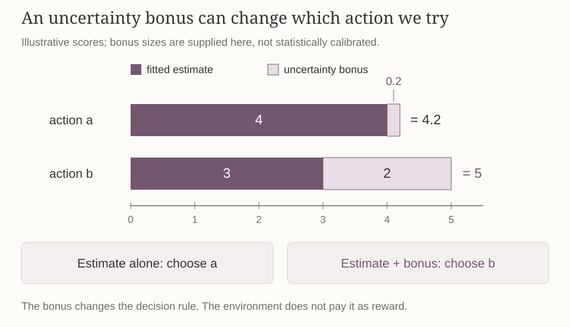{#fig-optimistic-action-scores fig-alt="Action a has estimate 4 and bonus 0.2, total 4.2. Action b has estimate 3 and bonus 2, total 5. Both bars share a common scale. Estimate alone chooses a; estimate plus bonus chooses b."}

This expression is a preview of exploration, rather than a complete algorithm or confidence theorem. Calibrating $\beta$, handling data dependence, specifying value ranges, and establishing performance guarantees require assumptions and analysis in the later linear-MDP lecture.

## Check your understanding

1. Why does a one-hot feature map represent every action-value table? What is lost when two different pairs are assigned identical features?
2. In the two-label example, compute the ridge solution for a general $\lambda\geq0$. Which objective is minimized, and why can the training fit become worse?
3. In the projection picture, what do the two axes mean? How do they differ from the axes in the three-state example $\widehat q(x)=w_1+w_2x$?
4. Why does the constructed function $x+2x(x-1)$ disprove a generalization guarantee based only on zero training error, while not contradicting recovery when the target is known to have the form $w_1+w_2x$?
5. Recompute the stage-1 targets and fitted weights in the job example. Why are the fitted initial score, optimal return, and fitted policy's return three different numbers?
6. Why is the identity design $I_3$ in the omitted-pair counterexample different from $I_5$ in tabular recovery?
7. Which part of the error proof needs a bound on every feasible pair? Why is a sum of squared training errors insufficient by itself?
8. State Bellman completeness with its quantifiers in order. How does the same-feature linear MDP model imply it, including the terminal backup?

This note develops the [Lecture 6 slides](../materials/slides/DPRL_lec06_function_approximation_and_lsvi.pdf), including the optional policy-loss proof. The exact-model formulation separates representation and approximation from the sampling and exploration questions studied later. The [course resources](../resources.md) provide complementary readings.

[Previous: Finite-horizon DP and online planning](finite-horizon-dp-and-online-planning.md) · [All course notes](index.md)
